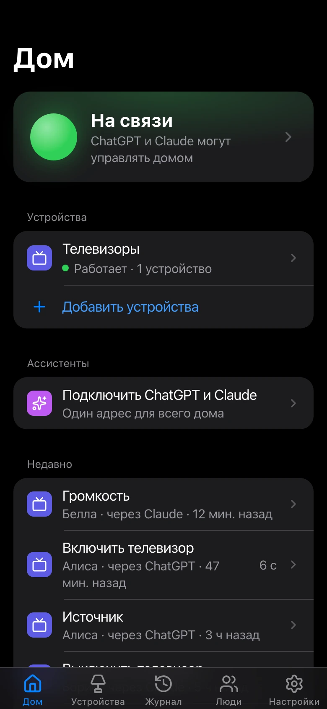
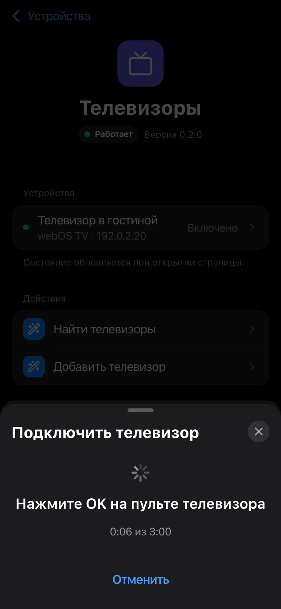
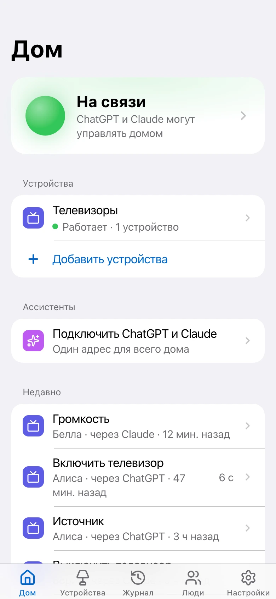
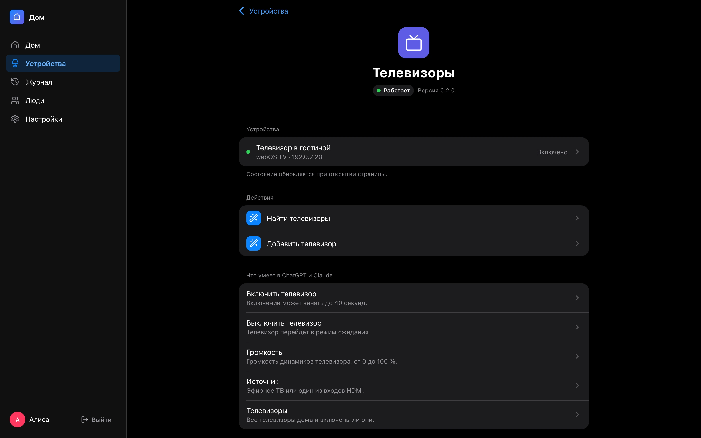
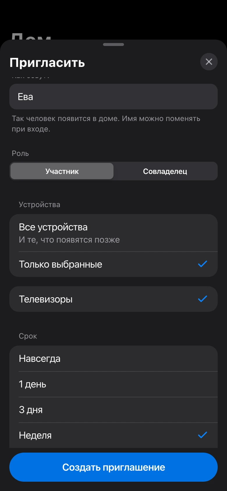
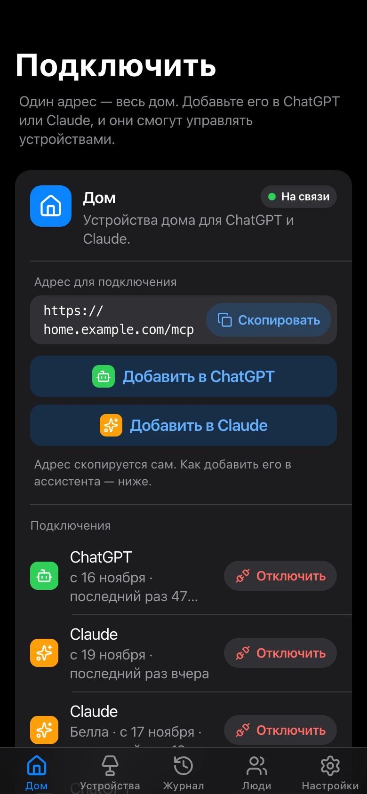
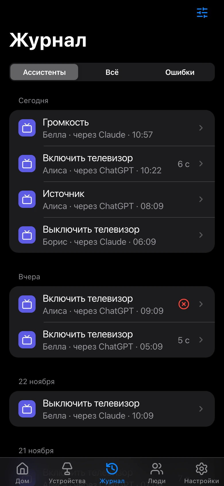
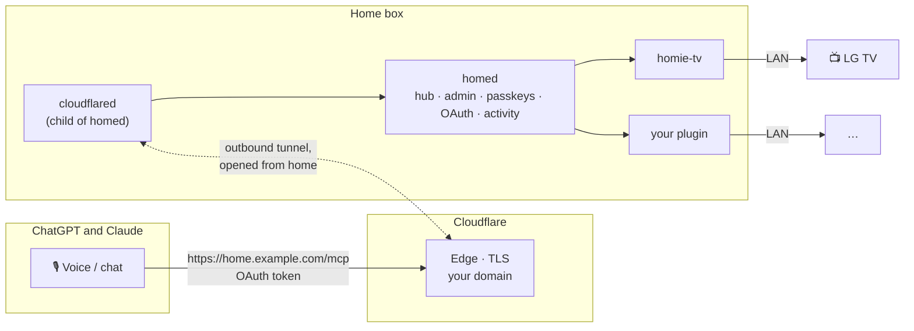

<p align="center">
  <picture>
    <source media="(prefers-color-scheme: dark)" srcset="docs/assets/banner-dark.svg">
    <source media="(prefers-color-scheme: light)" srcset="docs/assets/banner-light.svg">
    
  </picture>
</p>

<p align="center">
  <a href="https://github.com/devXpro/homie/actions/workflows/ci.yml"></a>
  <a href="https://github.com/devXpro/homie/releases"></a>
  <a href="go.mod"></a>
  <a href="LICENSE"></a>
</p>

<p align="center">
  <b>LLM-first home hub: ChatGPT and Claude run your home — by voice — through a Cloudflare Tunnel you own.</b>
</p>

<p align="center">
  <a href="docs/QUICKSTART.md">Quick start</a> ·
  <a href="docs/INSTALL-HOME.md">Install</a> ·
  <a href="docs/USING.md">Using it</a> ·
  <a href="docs/PLUGINS.md">Write a plugin</a> ·
  <a href="docs/README.md">All docs</a>
</p>

---

You say **«Включи телик»** to ChatGPT or Claude on your phone. A second later the living-room TV is on.

Homie is the small piece in between: a hub at home that turns your devices into tools the assistants can call, a
Cloudflare Tunnel that gives the hub a public HTTPS address on your own domain with nothing to rent and nothing to open,
and a beautiful admin to set it all up with Face ID.

## Why

- **The assistant is the interface.** No dashboards to build, no entity database, no automation YAML. Ask in plain
  words; the hub does exactly that and says so in one sentence.
- **Light.** One Go binary at home with the admin built in, small enough for a Raspberry Pi. No server to run, no
  database to install.
- **One address for the whole home.** Add `https://home.example.com/mcp` once as a connector in ChatGPT and once in
  Claude, and everyone you invite does the same with their own passkey.
- **Self-hosted, with one outside dependency.** Your domain, your home box. No Homie account, no telemetry. The only
  party in the middle is Cloudflare (it terminates TLS for your domain: [what that means](docs/SECURITY.md)).
- **No Home Assistant bloat.** If all you want is "talk to my TV", you should not have to run a platform.
- **Guests that expire.** An invite picks which devices a person may use and for how long; when the term ends, the
  access ends everywhere, and one tap extends it.

## Features

- 🎙️ **ChatGPT and Claude, chat and voice** — one OAuth connector per person; the tools and their descriptions come from the hub
- 🔐 **Passkeys only** — Face ID / Touch ID sign-in, step-up confirmation for dangerous actions, no passwords at all
- ☁️ **Cloudflare Tunnel** — your own domain (a named tunnel, made for you in one login) or a quick tunnel to try it in minutes
- 🏠 **Zero router setup** — the home box dials out; no port forwarding, no static IP
- 👨‍👩‍👧 **People** — one-time invites with devices and a term (a day, a week, until a date, forever), co-owners, revoke per person or per connection
- 🧩 **Plugins** — one executable per device family, any language, MCP over stdio; install from GitHub in the admin
- 📱 **iPhone-grade admin** — dark and light, phone and desktop, English and Russian, progress for long actions
- 🧾 **Activity log** — every call from every path, who asked and how long it took; secrets redacted
- ⬆️ **Safe updates** — verified releases, automatic rollback for plugins, self-update for the hub
- 📦 **Runs anywhere at home** — macOS, Raspberry Pi, any Linux, or a NAS with Docker

## Screenshots

<table>
  <tr>
    <td width="33%"></td>
    <td width="33%"></td>
    <td width="33%"></td>
  </tr>
  <tr>
    <td align="center"><sub>Home: can the assistants run it right now?</sub></td>
    <td align="center"><sub>Pairing a TV: “Press OK on the TV remote”</sub></td>
    <td align="center"><sub>Light mode follows your system</sub></td>
  </tr>
  <tr>
    <td colspan="3"></td>
  </tr>
  <tr>
    <td colspan="3" align="center"><sub>A module on the desktop: its devices, setup actions, and what it can do in ChatGPT and Claude</sub></td>
  </tr>
  <tr>
    <td></td>
    <td></td>
    <td></td>
  </tr>
  <tr>
    <td align="center"><sub>Invite: devices and a term</sub></td>
    <td align="center"><sub>Connect: one address, two assistants</sub></td>
    <td align="center"><sub>Activity: every action, who and how</sub></td>
  </tr>
</table>

More in the [admin tour](docs/USING.md).

## How it works



**One request, end to end:**

1. You say *"turn on the TV"*; the assistant calls `tv_power_on` on your home's connector.
2. It sends `POST https://home.example.com/mcp` with your OAuth token.
3. Cloudflare terminates TLS and passes the request down the tunnel your home box opened.
4. `homed` checks the token, your devices and term and the rate limit, calls the TV plugin over stdio and writes the
   activity entry.
5. `homie-tv` wakes the TV with Wake-on-LAN and waits until it answers; *"Living room TV is on."* travels back.

If the home box is off, the assistant says it cannot reach the home. More: [Architecture](docs/ARCHITECTURE.md).

## Quick start

You need a box at home that stays on, and — for the permanent setup — a domain whose DNS is on Cloudflare (a free
account is enough). No server.

On a Mac, a Raspberry Pi or any Linux box:

```sh
curl -fsSL https://raw.githubusercontent.com/devXpro/homie/main/install/home.sh | bash -s -- --domain home.example.com        # macOS
curl -fsSL https://raw.githubusercontent.com/devXpro/homie/main/install/home.sh | sudo bash -s -- --domain home.example.com   # Raspberry Pi / Linux
```

It installs the hub and `cloudflared`, starts the service, and prints a Cloudflare login link: sign in, pick your
domain's zone, and Homie creates the tunnel and the DNS record. Then `homed admin setup-link` prints a one-time link
for your passkey (Face ID), and the admin's **Connect** page shows the address to add in ChatGPT and Claude. To just
try it without a domain, use `--quick-tunnel` instead of `--domain …` (a temporary address, for you alone).

Homebrew, Docker for a NAS, connecting the assistants and voice: **[the full quick start](docs/QUICKSTART.md)**.

## Guides

| | |
|---|---|
| 🚀 [Quick start](docs/QUICKSTART.md) | home and the assistants, step by step |
| 🏠 [Install the home hub](docs/INSTALL-HOME.md) | Mac, Raspberry Pi, Linux, NAS; installer, Homebrew, Docker, source; Cloudflare; first run; upgrading from v0.1 |
| 📱 [Using Homie](docs/USING.md) | the admin tour, setting up a TV, connecting ChatGPT and Claude, voice, inviting people |
| 🧩 [Writing a plugin](docs/PLUGINS.md) | a 15-minute tutorial and the full protocol reference |
| 🏛️ [Architecture](docs/ARCHITECTURE.md) | components, flows, trust boundaries, design choices |
| 🔐 [Security model](docs/SECURITY.md) | every secret, what it unlocks, who can see what |
| 🩺 [Troubleshooting](docs/TROUBLESHOOTING.md) | the tunnel, 524, quick-tunnel limits, passkeys, TVs that do not wake |
| ❓ [FAQ](docs/FAQ.md) | the short answers |
| 📚 [All docs](docs/README.md) | including the admin API, development and testing |

## Plugins

Every device family is a plugin: a separate executable the hub starts and talks to over
[MCP](https://modelcontextprotocol.io) on stdio. Plugins live in their own repositories and install from the admin by
their GitHub address — the hub verifies the release, unpacks it safely and rolls back an update that does not start.

| Plugin | Devices | Status |
|---|---|---|
| [**homie-tv**](https://github.com/devXpro/homie-tv) | LG webOS TVs: power, volume, inputs; discovery and pairing in the admin | ✅ first plugin |
| *yours* | anything with an API: plugs, lights, a kettle, a vacuum | [write one →](docs/PLUGINS.md) |

Writing one takes about 15 minutes with [`pluginkit`](pluginkit) and the [template](templates/plugin): one file of
tools, a test, and a tag push that publishes the release the hub installs from.

```go
mcp.AddTool(s, &mcp.Tool{
	Name:        "plug_switch",
	Description: "Turns a smart plug on or off. Leave out plug when only one plug is set up.",
	// ...
}, h.switchPlug)
```

## Security at a glance

- **Passkeys only** for the admin (WebAuthn, verified at home), with a fresh Face ID / Touch ID for dangerous actions.
  The first passkey can only be created from the home box itself.
- **OAuth for the assistants**: a token per person and connection, hashed at rest, limited to the person's devices and
  term, revocable in a tap. Sign-in, OAuth and access checks are the public
  [MCP Gatekeeper](https://github.com/devXpro/mcp-gatekeeper).
- **The hub listens on loopback only** and is reached solely through the tunnel it opened itself.
- **Cloudflare terminates TLS** for your domain and can read the traffic, like any proxy in front of a site: protect the
  account (2FA). Quick tunnels are for trying and have no account behind them.
- **Plugins are trusted code** running as the hub's user; they never see callers' tokens and are not network-reachable.
- **Every action is logged**, with secret-looking arguments redacted.

The full model: **[SECURITY.md](docs/SECURITY.md)**. Found a problem? Open an issue without details and ask for a
private channel.

## Status and roadmap

Homie is young and used every day in one family. What works today (v0.2):

- ✅ Hub: the MCP endpoint with OAuth for ChatGPT and Claude, activity log, plugin host
- ✅ Cloudflare: your own domain in one login, or a quick tunnel to try; `cloudflared` as the hub's child
- ✅ People: invites with devices and a term, co-owners, extend and revoke
- ✅ Admin: passkeys, first run, devices with actions and progress, activity, settings, updates
- ✅ Plugins: `pluginkit`, install from GitHub with rollback; **homie-tv** for LG webOS

Next:

- ⏳ **More plugins** — smart plugs and lights first; newer LG firmware (`wss://:3001`)

## Development

```sh
make build    # the admin SPA, then bin/homed with it embedded
make test     # go test -race ./...
make lint     # golangci-lint v2
make e2e      # Playwright against a real homed
```

Go 1.26 (the `go` command fetches go1.26.11 by itself) and Node 22+. Running a development hub without a tunnel, or
with a fake cloudflared: [DEV.md](docs/DEV.md); every test suite: [TESTING.md](docs/TESTING.md).

## License

[MIT](LICENSE) © Homie contributors
