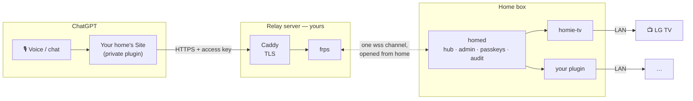

<p align="center">
  <picture>
    <source media="(prefers-color-scheme: dark)" srcset="docs/assets/banner-dark.svg">
    <source media="(prefers-color-scheme: light)" srcset="docs/assets/banner-light.svg">
    
  </picture>
</p>

<p align="center">
  <a href="https://github.com/devXpro/homie/actions/workflows/ci.yml"></a>
  <a href="https://github.com/devXpro/homie/releases"></a>
  <a href="go.mod"></a>
  <a href="LICENSE"></a>
</p>

<p align="center">
  <b>LLM-first home hub: ChatGPT runs your home — by voice — through a relay you own.</b>
</p>

<p align="center">
  <a href="docs/QUICKSTART.md">Quick start</a> ·
  <a href="docs/INSTALL-SERVER.md">Server</a> ·
  <a href="docs/INSTALL-HOME.md">Home</a> ·
  <a href="docs/USING.md">Using it</a> ·
  <a href="docs/PLUGINS.md">Write a plugin</a> ·
  <a href="docs/README.md">All docs</a>
</p>

---

You say **«Включи телик»** to ChatGPT on your phone. A second later the living-room TV is on.

Homie is the small piece in between: a hub at home that turns your devices into tools ChatGPT can call, a relay on
a server you own that gives the hub a public HTTPS address, and a beautiful admin to set it all up with Face ID.

## Why

- **The assistant is the interface.** No dashboards to build, no entity database, no automation YAML. Ask in plain
  words; the hub does exactly that and says so in one sentence.
- **Light.** One Go binary at home with the admin built in, small enough for a Raspberry Pi. The server side
  is Caddy and frps — two containers, no database.
- **Fast.** A persistent `wss` channel from home to the relay: no polling, no cloud round-trips through a vendor.
- **Self-hosted, end to end.** Your domain, your server, your home box. No Homie account, no telemetry, no
  third-party tunnel that terminates your TLS.
- **No Home Assistant bloat.** If all you want is "talk to my TV", you should not have to run a platform.
- **Voice via ChatGPT.** Each family member gets their own private plugin in their own ChatGPT account, named after
  your home — and it works in voice mode.

## Features

- 🎙️ **ChatGPT, chat and voice** — a private ChatGPT Site per person; tools and descriptions come from the hub
- 🔐 **Passkeys only** — Face ID / Touch ID sign-in, step-up confirmation for dangerous actions, no passwords at all
- 🛰️ **Your own relay** — one command on any Docker VPS; standalone or behind your existing Caddy, nginx or Traefik
- 🏠 **Zero router setup** — the home box dials out over 443; no port forwarding, no static IP
- 🧩 **Plugins** — one executable per device family, any language, MCP over stdio; install from GitHub in the admin
- 📱 **iPhone-grade admin** — dark and light, phone and desktop, English and Russian, progress for long actions
- 🧾 **Activity log** — every call from every path, who asked and how long it took; secrets redacted
- 🔑 **Per-person access keys** — hashed at rest, scoped to the plugins each person may use, revocable in a tap
- ⬆️ **Safe updates** — verified releases, automatic rollback for plugins, self-update for the hub
- 📦 **Runs anywhere at home** — macOS, Raspberry Pi, any Linux, or a NAS with Docker

## Screenshots

<table>
  <tr>
    <td width="33%"></td>
    <td width="33%"></td>
    <td width="33%"></td>
  </tr>
  <tr>
    <td align="center"><sub>Home: is ChatGPT able to run it right now?</sub></td>
    <td align="center"><sub>Pairing a TV: “Press OK on the TV remote”</sub></td>
    <td align="center"><sub>Light mode follows your system</sub></td>
  </tr>
  <tr>
    <td colspan="3"></td>
  </tr>
  <tr>
    <td colspan="3" align="center"><sub>A module on the desktop: its devices, setup actions, and what it can do in ChatGPT</sub></td>
  </tr>
  <tr>
    <td></td>
    <td></td>
    <td></td>
  </tr>
  <tr>
    <td align="center"><sub>Activity: every action, who and how</sub></td>
    <td align="center"><sub>Settings: passkeys, keys, server, updates</sub></td>
    <td align="center"><sub>Sign in: just Face ID</sub></td>
  </tr>
</table>

More in the [admin tour](docs/USING.md).

## How it works



**One request, end to end:**

1. You say *"turn on the TV"*; ChatGPT calls `tv_power_on` on your home's Site.
2. The Site sends `POST https://home.example.com/api/v1/tools/tv_power_on` with your access key.
3. Caddy terminates TLS; frps passes the request down the channel your home box opened.
4. `homed` checks the key, your scopes and the rate limit, calls the TV plugin over stdio and writes the audit entry.
5. `homie-tv` wakes the TV with Wake-on-LAN and waits until it answers; *"Living room TV is on."* travels back.

If the home box is offline, the relay answers with a "home is offline" page and ChatGPT says so plainly. More:
[Architecture](docs/ARCHITECTURE.md).

## Quick start

You need a small Linux VPS with Docker, a domain, and a box at home that stays on.

**Server — 5 minutes.** Point an A record (DNS only) at the VPS, then:

```sh
curl -fsSL https://raw.githubusercontent.com/devXpro/homie/main/install/server.sh \
  | sudo bash -s -- --domain home.example.com
```

It gets a certificate, starts the relay and prints a **connect code** (`ghr1.…`). Keep it secret.

**Home — 5 minutes.** On a Mac, a Raspberry Pi or any Linux box:

```sh
curl -fsSL https://raw.githubusercontent.com/devXpro/homie/main/install/home.sh | bash        # macOS
curl -fsSL https://raw.githubusercontent.com/devXpro/homie/main/install/home.sh | sudo bash   # Raspberry Pi / Linux
```

Open the first-run address it prints on your phone, type the PIN, paste the connect code, and create your passkey
with Face ID. Then **Devices → Add devices** in the admin at `https://home.example.com/admin`.

Homebrew, Docker for a NAS, connecting ChatGPT and voice: **[the full quick start](docs/QUICKSTART.md)**.

## Guides

| | |
|---|---|
| 🚀 [Quick start](docs/QUICKSTART.md) | server, home and ChatGPT in three five-minute blocks |
| 🛰️ [Install the relay server](docs/INSTALL-SERVER.md) | DNS, the installer, standalone or behind your proxy, firewall, token rotation |
| 🏠 [Install the home hub](docs/INSTALL-HOME.md) | Mac, Raspberry Pi, Linux, NAS; installer, Homebrew, Docker, source; first run |
| 📱 [Using Homie](docs/USING.md) | the admin tour, setting up a TV, connecting ChatGPT, voice, family |
| 🧩 [Writing a plugin](docs/PLUGINS.md) | a 15-minute tutorial and the full protocol reference |
| 🏛️ [Architecture](docs/ARCHITECTURE.md) | components, flows, trust boundaries, design choices |
| 🔐 [Security model](docs/SECURITY.md) | every secret, what it unlocks, who can see what |
| 🩺 [Troubleshooting](docs/TROUBLESHOOTING.md) | offline home, certificates, passkeys, TVs that do not wake |
| ❓ [FAQ](docs/FAQ.md) | the short answers |
| 📚 [All docs](docs/README.md) | including the admin API, development and testing |

## Plugins

Every device family is a plugin: a separate executable the hub starts and talks to over
[MCP](https://modelcontextprotocol.io) on stdio. Plugins live in their own repositories and install from the admin by
their GitHub address — the hub verifies the release, unpacks it safely and rolls back an update that does not start.

| Plugin | Devices | Status |
|---|---|---|
| [**homie-tv**](https://github.com/devXpro/homie-tv) | LG webOS TVs: power, volume, inputs; discovery and pairing in the admin | ✅ first plugin |
| *yours* | anything with an API: plugs, lights, a kettle, a vacuum | [write one →](docs/PLUGINS.md) |

Writing one takes about 15 minutes with [`pluginkit`](pluginkit) and the [template](templates/plugin): one file of
tools, a test, and a tag push that publishes the release the hub installs from.

```go
mcp.AddTool(s, &mcp.Tool{
	Name:        "plug_switch",
	Description: "Turns a smart plug on or off. Leave out plug when only one plug is set up.",
	// ...
}, h.switchPlug)
```

## Security at a glance

- **Passkeys only** for the admin (WebAuthn, verified at home), with a fresh Face ID / Touch ID for dangerous actions.
  The first passkey can only be created from the home box itself.
- **Access keys** for ChatGPT are stored as SHA-256 hashes, scoped per person, rate-limited and revocable.
- **The hub listens on loopback only** and is reached solely through the channel it opened itself.
- **The relay server terminates TLS** and is trusted like your domain: run it on a server you control, without a
  TLS-terminating CDN. Its token is a secret; rotate it with one command.
- **Plugins are trusted code** running as the hub's user; they never see callers' keys and are not network-reachable.
- **Every action is audited**, with secret-looking arguments redacted.

The full model: **[SECURITY.md](docs/SECURITY.md)**. Found a problem? Open an issue without details and ask for a
private channel.

## Status and roadmap

Homie is young and used every day in one family. What works today:

- ✅ Relay server: installer, standalone and behind-proxy modes, offline page
- ✅ Hub: REST façade and MCP endpoint, access keys, audit, plugin host, embedded relay client
- ✅ Admin: passkeys, first run, devices with actions and progress, activity, settings, updates
- ✅ Plugins: `pluginkit`, install from GitHub with rollback; **homie-tv** for LG webOS
- ✅ ChatGPT: a private Site per person (path B), voice

Next:

- ⏳ **People and invites (phase 3)** — invite family members with a link: their own passkey, their own name in the
  log, their own set of devices, their ChatGPT Site published from the admin
- ⏳ **Path A** — a custom MCP connector added by URL, with an OAuth 2.1 server in the hub
- ⏳ **More plugins** — smart plugs and lights first; newer LG firmware (`wss://:3001`)

The detailed plan: [docs/PLAN.md](docs/PLAN.md).

## Development

```sh
make build    # the admin SPA, then bin/homed with it embedded
make test     # go test -race ./...
make lint     # golangci-lint v2
make e2e      # Playwright against a real homed
```

Go 1.26 (the `go` command fetches go1.26.11 by itself) and Node 22+. Running a development hub without a relay:
[DEV.md](docs/DEV.md); every test suite: [TESTING.md](docs/TESTING.md).

## License

[MIT](LICENSE) © Homie contributors
