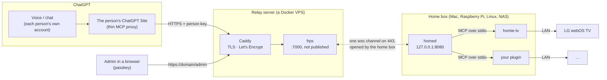
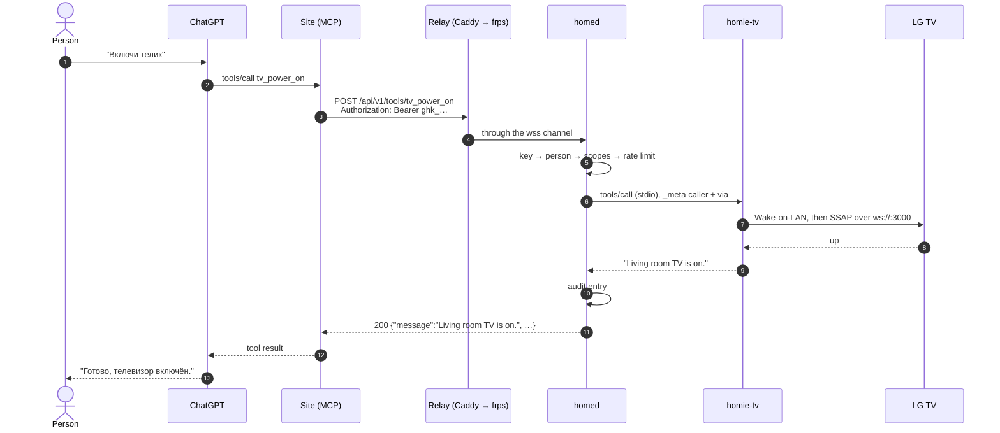
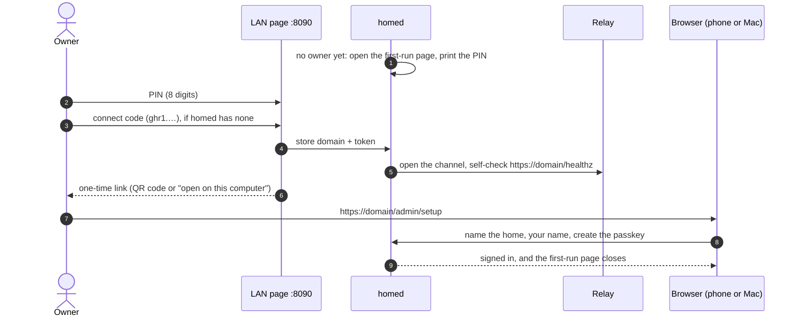

# Architecture

Homie is three small things and a protocol between them:

- **the relay** — Caddy and frps on a public server: a dumb pipe with a domain and a certificate;
- **the hub** — `homed`, one Go binary at home: the API ChatGPT calls, the admin, passkeys, people and keys, the
  audit log, the plugin host and the relay client;
- **plugins** — one executable per device family (`homie-tv` for LG TVs), started by the hub and spoken to over stdio.

Everything that matters lives at home. The server holds no keys, no database and no device code.



## Components

| Component | Where | What it does | Source |
|---|---|---|---|
| Caddy | relay server | TLS for the domain, reverse proxy to frps with `stream_close_delay 30m` | [`relay/`](../relay) |
| frps (frp v0.72.0) | relay server | accepts the home's channel on `GET /~!frp` (token auth) and forwards every other request through it; serves the "home is offline" page when no home is connected | [`relay/frps.toml`](../relay/frps.toml) |
| Relay client | in `homed` | frp's client, embedded: `wss` to `<domain>:443` with verified TLS, retries forever, one `http` proxy to `127.0.0.1:<port>`; self-check every 30 s | [`internal/relay`](../internal/relay) |
| Gateway | in `homed` | the REST façade (`/api/v1/tools`) for ChatGPT Sites and the MCP endpoint (`/mcp`); bearer person keys, scopes, rate limit, audit | [`internal/gateway`](../internal/gateway) |
| Admin API + SPA | in `homed` | `/admin` (React, embedded in the binary) and `/api/admin/…` behind passkey sessions | [`internal/admin`](../internal/admin), [`web/`](../web) |
| Auth | in `homed` | WebAuthn passkeys (RP ID = the relay domain), sessions, step-up, setup links, the LAN first-run page | [`internal/auth`](../internal/auth), [`internal/firstrun`](../internal/firstrun) |
| Plugin host | in `homed` | starts plugins, speaks MCP over stdio, merges their tools, restarts crashed ones | [`internal/plugins`](../internal/plugins) |
| Installer | in `homed` | installs and updates plugins from GitHub releases (checksums, safe unpack, rollback); updates `homed` itself | [`internal/install`](../internal/install) |
| Store | in `homed` | SQLite (pure Go): people, passkeys, sessions, key hashes, plugins, audit, settings | [`internal/store`](../internal/store) |
| Local socket | in `homed` | `<data dir>/homed.sock`: the CLI talks to the running hub over it | [`cmd/homed`](../cmd/homed) |
| Plugins | home box | device code, one executable per family, any language | [`pluginkit/`](../pluginkit), [homie-tv](https://github.com/devXpro/homie-tv) |
| ChatGPT Site | OpenAI's hosting | a per-person MCP server that forwards tool calls to the hub's REST façade | [`site/`](../site) |

## Request flows

### "Turn on the TV" (an assistant call)



The REST façade answers `200` with the tool's structured result, `422` when the tool ran and failed (the TV is not
paired), `404` for an unknown or forbidden tool, `429` over 120 calls a minute per key, `503` when the plugin is down
and `504` on a timeout. The full table is in [PLAN §5.4](PLAN.md#54-hub-public-http-surface-served-on-1270018080-reached-through-the-relay).

### The home is offline

No home channel is connected (the Mac sleeps, the Pi lost power), so frps answers every request with its offline
page: HTML, status `404`. The Site tells a JSON `404` (unknown tool) from this HTML one and says *"The home hub is
offline right now"*. `https://<domain>/healthz` shows the same from anywhere: `{"ok":true}` when the home is
connected, the offline page when it is not.

### The admin

The browser loads `https://<domain>/admin` through the same channel: the SPA is served by `homed`, not by the
server. Sign-in is a WebAuthn ceremony verified **at home**; the session cookie is `HttpOnly; Secure;
SameSite=Strict`, and every mutating request also needs the header `X-Homie: 1`. Dangerous actions (install or
remove a plugin, create or revoke a key, add or remove a passkey, change the relay, update the hub) need a passkey
assertion no older than five minutes.

### First run



Without the page (a headless Pi over SSH), `homed relay connect -` and `homed admin setup-link` do the same from a
terminal.

### Installing a plugin

Admin → Devices → Add devices → `owner/repo` → the hub reads the latest GitHub release, downloads
`homie-plugin.json`, picks `<binary>_<version>_<os>_<arch>.tar.gz` for this machine, checks its SHA-256 against
`checksums.txt`, unpacks it into `plugins/<id>/bin/<version>/` (no links, no `..`, size caps), starts it and waits for
`tools/list`. An update that does not start is rolled back to the previous version. See
[PLUGINS.md](PLUGINS.md#releasing).

## Trust boundaries

```
 untrusted internet │ relay server (trusted like the domain) │ home box: one OS user, fully trusted │ LAN devices
                    │                                        │                                      │
 ChatGPT, Sites ───TLS──▶ Caddy ─▶ frps ◀══ wss (token) ═════ homed ──stdio──▶ plugins ──────────────▶ TV …
 browsers           │   sees plaintext requests              │  keys hashed, passkeys verified here  │
```

- **The relay server terminates TLS**, so it can read requests, person keys in headers included. It cannot forge a
  passkey assertion, so on its own it cannot start a step-up action; but a compromised server can steal a live
  session or a fresh setup link, or serve tampered admin pages. Run it on a server you control, with no TLS-terminating
  CDN in front.
- **The relay token** (inside the connect code) lets its holder register the domain while the home is offline and
  answer in its place. Keep it as secret as the person keys; rotate it when in doubt.
- **The hub listens on loopback only.** A Host allowlist (the relay domain and its own loopback address) answers
  anything else with `421`.
- **Plugins run as the hub's OS user and are fully trusted**: they can read everything that user can, `relay-token`
  and `homed.db` included. They are not reachable from the network, never see callers' keys, and get only a minimal
  environment.
- **Person keys** (`ghk_…`) are stored as SHA-256 hashes; each person sees only the assistant tools of the plugins
  they may use.

The full model, with what each secret unlocks: [SECURITY.md](SECURITY.md).

## Data dir

One directory holds all state; mode `0700`. Default: `~/Library/Application Support/homie` on macOS,
`$XDG_DATA_HOME/homie` (or `~/.local/share/homie`) on Linux, and `/var/lib/homie` when the system service sets
it. `--data-dir` or `HOMED_DATA_DIR` overrides it.

| Path | What |
|---|---|
| `homed.yaml` | `listen`, `setup_listen`, `relay.domain` — what homed needs before the database opens |
| `relay-token` | the frps token, `0600` |
| `instance-id` | random id sent as `X-Homie-Instance`; the relay self-check looks for it |
| `homed.db` | SQLite, `0600`: people, passkeys, sessions, key hashes, plugins, audit, home name, language |
| `homed.sock` | the local admin socket of the running hub, `0600`, own OS user only |
| `.homed.lock` | the instance lock: one `homed run` per data dir |
| `logs/<plugin>.log` | each plugin's stderr, rotated at 5 MB, three files |
| `plugins/<id>/data/` | the plugin's own state (`HOMIE_DATA_DIR`), e.g. homie-tv's `tvs.json` |
| `plugins/<id>/bin/<version>/` | plugin releases installed from GitHub |

Back it up as a whole, and treat the backup as a secret: it holds the relay token and the TV pairing keys.

## Why these choices

**Why a relay and not port forwarding or a VPN?** ChatGPT has to reach the home from the internet. Port forwarding
needs a static IP and a router that cooperates, and exposes the box. A mesh VPN does not help: ChatGPT is not on it.
A $4 VPS with a domain gives a stable HTTPS address, and the home box only ever dials **out**.

**Why frp?** It does exactly this job — an authenticated tunnel that multiplexes the control channel and the public
traffic on one port — and it is embeddable in Go, so the home side is one binary with no extra daemon. Over `wss` on
443 it passes through anything that allows HTTPS. `stream_close_delay` keeps the channel alive across Caddy reloads.

**Why MCP for plugins?** It is the protocol assistants already speak, with schemas, annotations, progress and
cancellation built in. A plugin's tools reach ChatGPT unchanged: the hub filters, scopes and audits, but does not
translate. Any language with an MCP SDK can write a plugin, and stdio means no ports, no network exposure and a
process the hub fully controls.

**Why a ChatGPT Site (path B)?** A Site is a private plugin in the person's own ChatGPT account that works in the
iPhone app and in voice, with no OAuth server to run. It is a thin proxy, so the tools and their descriptions still
come from the hub. A custom MCP connector with OAuth (path A) remains the alternative.

**Why passkeys?** No passwords to leak or reset, Face ID and Touch ID on every device, and phishing resistance: a
passkey is bound to the domain. The first one can only be made from the home box itself (the LAN page or the CLI), so
the server alone can never create an owner.

**Why no dashboards, no entity model, no automation engine?** The interface is the assistant. The admin exists to set
things up and to see what happened; everything else is a sentence to ChatGPT. That keeps the hub one small binary
that runs on a Raspberry Pi.
