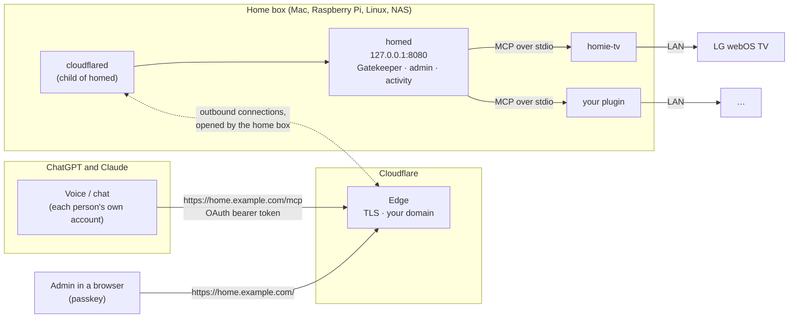
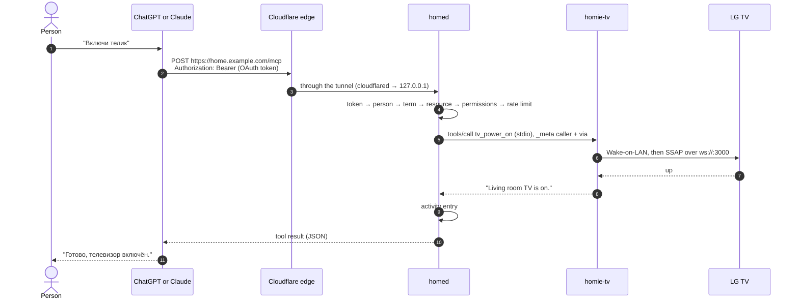

# Architecture

Homie is three small things and a protocol between them:

- **the hub** — `homed`, one Go binary at home: the MCP endpoint ChatGPT and Claude call, the admin, passkeys, people
  and invites, the activity log, the plugin host, and a Cloudflare tunnel that it runs as a child process;
- **MCP Gatekeeper** — the public Go library that does the sign-in and the access control inside `homed`: passkeys,
  sessions, an OAuth 2.1 server for the assistants, the MCP gate, people and invites. Homie uses it as a library;
- **plugins** — one executable per device family (`homie-tv` for LG TVs), started by the hub and spoken to over stdio.

Between the internet and the hub sits **Cloudflare** only: a tunnel that the home box opens outward, so nothing is
published at home and no port is forwarded. There is no relay server to run.



## Components

| Component | Where | What it does | Source |
|---|---|---|---|
| Cloudflare edge | Cloudflare | terminates TLS for your domain (or a `trycloudflare.com` host in quick mode) and forwards requests through the tunnel | — |
| `cloudflared` | home box, a child of `homed` | keeps the tunnel up; restarted with a backoff when it exits; its output goes to `logs/cloudflared.log` | [`internal/tunnel`](../internal/tunnel), the gatekeeper's `tunnel/cloudflare` |
| Tunnel manager | in `homed` | connect (domain, quick), status, the self-check (`GET https://<host>/healthz` must carry this hub's `X-Homie-Instance`), reconnect | [`internal/tunnel`](../internal/tunnel) |
| Sign-in and OAuth | in `homed`, from MCP Gatekeeper | WebAuthn passkeys, sessions, step-up, setup links and invites; the OAuth 2.1 server (dynamic client registration, PKCE, consent) that ChatGPT and Claude use | [mcp-gatekeeper](https://github.com/devXpro/mcp-gatekeeper) `auth`, `oauth` |
| MCP gate | in `homed`, from MCP Gatekeeper | checks the access token on `/mcp`, the person, the term and the resource, and rate limits | [mcp-gatekeeper](https://github.com/devXpro/mcp-gatekeeper) `mcpguard`, `httpsec` |
| People | in `homed`, from MCP Gatekeeper | members, co-owners, invites with devices and a term, connections, the audit of admin actions | [mcp-gatekeeper](https://github.com/devXpro/mcp-gatekeeper) `people` |
| Gateway | in `homed` | the MCP endpoint `/mcp` (stateless, JSON): lists and calls the tools a person's permissions allow, 120 calls per minute per connection | [`internal/gateway`](../internal/gateway) |
| Admin API + SPA | in `homed` | the admin (React on the gatekeeper's UI package, embedded in the binary) and `/api/home/…` | [`internal/admin`](../internal/admin), [`web/`](../web) |
| First-run page | in `homed` | a PIN-gated page on the home box that connects Cloudflare and makes the first setup link | [`internal/firstrun`](../internal/firstrun) |
| Plugin host | in `homed` | starts plugins, speaks MCP over stdio, merges their tools, restarts crashed ones | [`internal/plugins`](../internal/plugins) |
| Installer | in `homed` | installs and updates plugins from GitHub releases (checksums, safe unpack, rollback); updates `homed` itself | [`internal/install`](../internal/install) |
| Store | in `homed` | one SQLite file `homie.db` on the gatekeeper's `sqlitestore`: its `gk_*` tables plus Homie's plugins, settings and activity | [`internal/store`](../internal/store) |
| Admin socket | in `homed` | `<data dir>/homed.sock`: the CLI talks to the running hub over it; also `setup-link` and `reset-access` | [`cmd/homed`](../cmd/homed), the gatekeeper's `adminsock` |
| Plugins | home box | device code, one executable per family, any language | [`pluginkit/`](../pluginkit), [homie-tv](https://github.com/devXpro/homie-tv) |

## One home, one address

The whole home is **one MCP resource at one address**: `https://<host>/mcp`. Each person adds that address once as a
connector in ChatGPT and once in Claude, and signs in with their own passkey. What a person can reach is decided on
the hub, from the **permissions** stored with them:

- `all` — every device, present and future (owners always);
- `plugin:<id>` — the devices of one plugin, e.g. `plugin:tv`.

A person with no permissions sees no tools at all. The gateway filters `tools/list` and refuses `tools/call` outside
the permissions; the plugin never learns who asked beyond an informational `_meta` (`homie/caller`, `homie/via`).

People are one of:

| Role | Who | Can |
|---|---|---|
| **Superadmin owner** | the person who set the home up | everything; the only one who changes or removes an owner, or resets access |
| **Co-owner** | a partner, invited by the superadmin | every device, no end date; invites and manages members and guests, revokes connections, reads the audit |
| **Member / guest** | family, friends | the devices ticked in the invite, until the term ends; sees their own devices, connections and activity only |

## Request flows

### "Turn on the TV" (an assistant call)



`/mcp` is stateless JSON: a `POST` answers with `application/json`, and `GET` answers `405`. Assistant tool calls are
capped at 90 seconds, under Cloudflare's own proxy timeout. See [ADMIN-API.md](ADMIN-API.md) for `/api/home/*`.

### Connecting an assistant (OAuth)

1. The person adds `https://<host>/mcp` as a connector. The assistant fetches `/.well-known/oauth-protected-resource/mcp`
   and the authorization server metadata, and registers itself (dynamic client registration).
2. The assistant opens the consent page on the hub's own address. The person signs in with their passkey if they have
   no session, and taps **Allow**.
3. The assistant exchanges the code (PKCE) for an access token (one hour) and a refresh token (30 days). The access
   token is for this one resource, and it ends no later than the person's term, if they have one.
4. Every call carries the token; the gate checks it again, so a revoked connection or an ended term stops at once.

### The home is unreachable

If the home box sleeps or loses its network, `cloudflared` has nothing to connect to, and Cloudflare answers every
request with its own error page (typically `530`, error `1033`). The admin shows the same state from the home side
(*not reachable from outside*); [TROUBLESHOOTING.md](TROUBLESHOOTING.md) lists the states.

### The admin

The browser loads `https://<host>/` through the tunnel: the SPA is served by `homed`. Sign-in is a WebAuthn ceremony
verified **at home**; the session cookie is `__Host-homie_session` (`HttpOnly; Secure; SameSite=Strict`), and every
mutating request also needs the header `X-Homie: 1`. Dangerous actions (install or remove a plugin, update the hub,
reconnect the tunnel, add a person's access) need a passkey assertion no older than five minutes.

### First run

```mermaid
sequenceDiagram
    autonumber
    actor O as Owner
    participant L as First-run page :8090
    participant H as homed
    participant C as Cloudflare
    participant B as Browser
    H->>H: no owner yet: open the first-run page, print the PIN
    O->>L: PIN (8 digits)
    O->>L: "My domain" (host name) or "Try without a domain"
    L->>H: connect job
    H->>C: Cloudflare login link → tunnel → DNS record (or a quick tunnel)
    H->>C: self-check https://host/healthz
    L-->>O: one-time link (QR code or "open on this computer")
    O->>B: https://host/setup#t=…
    B->>H: name the home, create the passkey
    H-->>B: signed in; the first-run page closes
```

Without the page (a headless Pi over SSH), `homed cloudflare connect <host>` and `homed admin setup-link` do the same
from a terminal.

### Quick mode: the address changes

A quick tunnel's `*.trycloudflare.com` host is random and changes whenever `cloudflared` starts again, including every
restart of `homed`. A host on that domain cannot share a passkey with another, so every new address needs a new
passkey, and every connector has to be added again. `homed` rebuilds its sign-in and OAuth stack for the new address,
refuses the old Host with `421`, and reopens the first-run page on the home box with a **Reconnect** button that issues
a new setup link for the same owner. Quick mode is owner-only: inviting people is off.

### Installing a plugin

Admin → Devices → Add devices → `owner/repo` → the hub reads the latest GitHub release, downloads
`homie-plugin.json`, picks `<binary>_<version>_<os>_<arch>.tar.gz` for this machine, checks its SHA-256 against
`checksums.txt`, unpacks it into `plugins/<id>/bin/<version>/` (no links, no `..`, size caps), starts it and waits for
`tools/list`. An update that does not start is rolled back to the previous version. See
[PLUGINS.md](PLUGINS.md#releasing).

## Trust boundaries

```
 untrusted internet │ Cloudflare (trusted like your DNS │ home box: one OS user, fully trusted │ LAN devices
                    │  provider; terminates TLS)        │                                      │
 ChatGPT, Claude ───TLS──▶ edge ◀══ tunnel (outbound) ═══ cloudflared ─▶ homed ──stdio──▶ plugins ──▶ TV …
 browsers           │  sees plaintext requests          │  passkeys verified here, tokens checked here
```

- **Cloudflare terminates TLS**, so it can read requests: bearer tokens, tool arguments and results, session cookies,
  admin pages and setup links in flight. It cannot forge a passkey assertion, so on its own it cannot start a step-up
  action; but an account takeover at Cloudflare, or Cloudflare itself, can steal a live session, serve tampered admin
  pages, or answer in the home's place. Use a Cloudflare account you protect (2FA) and a domain you control.
- **The tunnel credentials** (`tunnel/credentials.json`, `0600`) let their holder run the same tunnel. They never
  leave the home box and never travel through argv.
- **The hub listens on loopback only** (`127.0.0.1:<port>`). A Host allowlist (the public host and its own loopback
  address) answers anything else with `421`. The client's address comes from `CF-Connecting-IP`, trusted only from
  loopback peers.
- **`cloudflared` runs as the hub's child** with a private empty `HOME`, a minimal environment and no secret on its
  command line.
- **Plugins run as the hub's OS user and are fully trusted**: they can read everything that user can, `homie.db` and
  the tunnel credentials included. They are not reachable from the network and get only a minimal environment.
- **Tokens and keys** are stored as SHA-256 hashes only.

The full model, with what each secret unlocks: [SECURITY.md](SECURITY.md).

## Data dir

One directory holds all state; mode `0700`. Default: `~/Library/Application Support/homie` on macOS,
`$XDG_DATA_HOME/homie` (or `~/.local/share/homie`) on Linux, and `/var/lib/homie` when the system service sets it.
`--data-dir` or `HOMED_DATA_DIR` overrides it.

| Path | What |
|---|---|
| `homed.yaml` | `listen`, `setup_listen` and the `tunnel:` block (`mode`, `hostname`, `cloudflared`): what homed needs before the database opens |
| `instance-id` | random id sent as `X-Homie-Instance`; the tunnel self-check looks for it |
| `homie.db` | SQLite, `0600`: people, passkeys, sessions, OAuth clients and grants, invites, plugins, settings, activity, the audit of admin actions |
| `homed.sock` | the local admin socket of the running hub, `0600`, own OS user only |
| `.homed.lock` | the instance lock: one `homed run` per data dir |
| `tunnel/` | `0700`: `config.yml`, `credentials.json` and `tunnel.json` (`0600`) of the named tunnel, and an empty private `HOME` for `cloudflared` |
| `logs/<plugin>.log`, `logs/cloudflared.log` | each plugin's stderr and `cloudflared`'s output, rotated at 5 MB, three files |
| `plugins/<id>/data/` | the plugin's own state (`HOMIE_DATA_DIR`), e.g. homie-tv's `tvs.json` |
| `plugins/<id>/bin/<version>/` | plugin releases installed from GitHub |

Back it up as a whole, and treat the backup as a secret: it holds the tunnel credentials and the TV pairing keys.

Upgrading from v0.1 is automatic and keeps the plugins, the home name and the language: see
[INSTALL-HOME.md](INSTALL-HOME.md#upgrading-from-v01).

## Why these choices

**Why Cloudflare Tunnel and not port forwarding or a VPN?** The assistants have to reach the home from the internet.
Port forwarding needs a static IP and a router that cooperates, and exposes the box; a mesh VPN does not help, because
ChatGPT is not on it. A Cloudflare Tunnel is outbound only, gives a stable HTTPS address on your own domain at no
cost, and needs no server of yours. The price is trust in Cloudflare (above). Quick tunnels need no account at all, at
the cost of an address that changes.

**Why `cloudflared` as a child and not a separate service?** One service, one installer path, the same on macOS,
Linux and Docker, and the hub sees the tunnel's state and the quick-tunnel address directly. A restart of the hub (an
update, a crash) drops the tunnel for a few seconds; in quick mode it also changes the address.

**Why MCP Gatekeeper?** The sign-in, the OAuth server for ChatGPT and Claude, and the access checks are security code
that Homie should not write twice. The gatekeeper is a separate public library with its own tests and review notes; the
same code guards [other MCP servers](https://github.com/devXpro/mcp-gatekeeper).

**Why MCP for plugins?** It is the protocol assistants already speak, with schemas, annotations, progress and
cancellation built in. A plugin's tools reach the assistants unchanged: the hub filters, scopes and logs, but does not
translate. Any language with an MCP SDK can write a plugin, and stdio means no ports, no network exposure and a
process the hub fully controls.

**Why passkeys?** No passwords to leak or reset, Face ID and Touch ID on every device, and phishing resistance: a
passkey is bound to the host. The first one can only be made from the home box itself (the first-run page or the CLI),
so nobody who merely reaches the address can claim the home.

**Why no dashboards, no entity model, no automation engine?** The interface is the assistant. The admin exists to set
things up and to see what happened; everything else is a sentence to the assistant. That keeps the hub one small
binary that runs on a Raspberry Pi.
