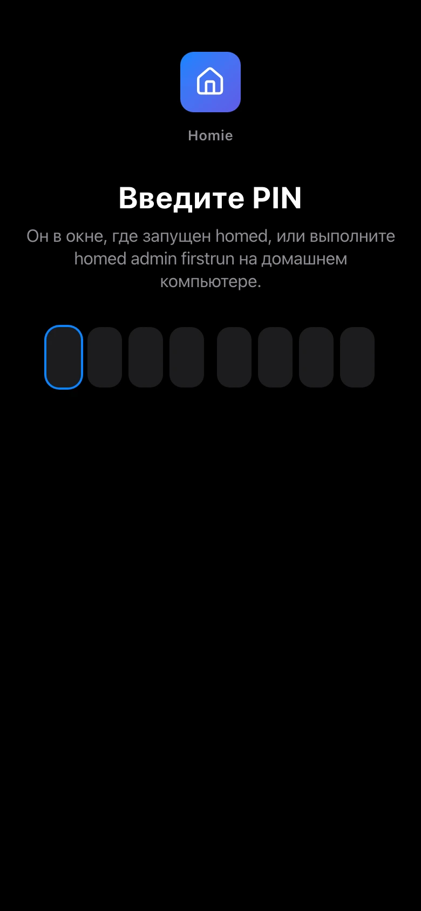
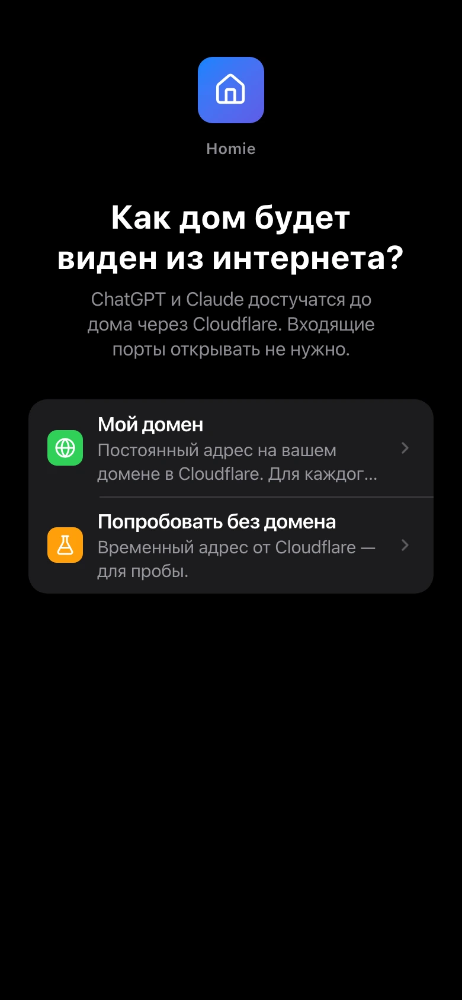

# Install the home hub

`homed` is the hub: one binary that runs at home, keeps one outbound tunnel to Cloudflare, serves the admin and the
MCP address for ChatGPT and Claude, holds your passkeys, people and activity log, and runs the device plugins. This
page covers where it can run, how to install it, how to connect it to the internet, and the first five minutes after
that.

You need nothing on a server. For the main path you need **a domain whose DNS is on Cloudflare** (a free Cloudflare
account is enough); to just try Homie you need nothing at all.

- [Where the hub can run](#where-the-hub-can-run)
- [Pick how it reaches the internet](#pick-how-it-reaches-the-internet)
- [Install](#install): [macOS](#macos) · [Raspberry Pi and Linux](#raspberry-pi-and-linux) · [Docker (NAS)](#docker-nas) · [from source](#from-source)
- [Connect Cloudflare](#connect-cloudflare)
- [First run: create your passkey](#first-run-create-your-passkey)
- [Add your first device](#add-your-first-device)
- [Running as a service](#running-as-a-service)
- [Updates](#updates)
- [Upgrading from v0.1](#upgrading-from-v01)
- [Uninstall](#uninstall)
- [Backups](#backups)

## Where the hub can run

The hub must be **always on** (the assistants cannot reach a sleeping home) and **on the same network as your
devices** (plugins find them with multicast and wake them with broadcast packets). It needs outbound HTTPS and
nothing inbound: no port forwarding, no static IP.

| Box | Notes |
|---|---|
| **A Mac that stays on** | Apple Silicon or Intel, recent macOS. A Mac mini or an iMac is ideal; a laptop works while it is awake and online. Runs as a LaunchAgent in your login session. |
| **Raspberry Pi 5, 4, 3 or Zero 2 W** | the best 24/7 home box: silent, a few watts. Use **Raspberry Pi OS Lite (64-bit)**; the 32-bit OS works too (armv7). The original Pi Zero and Pi 1 (ARMv6) are not supported. Prefer Ethernet for the TV's sake. |
| **Any Linux box** | amd64, arm64 or armv7 with systemd: a mini PC, an old laptop, a home server. |
| **A NAS with Docker** | Synology, QNAP, Unraid, TrueNAS and the like, with **host networking**. |

Not supported: Docker Desktop on macOS or Windows (its "host network" is a Linux VM, not your LAN, so devices cannot
be found or woken), and Windows itself.

| How | For | Updates |
|---|---|---|
| [**One-command installer**](#macos) `install/home.sh` | macOS, Raspberry Pi, Linux | the admin, or rerun the installer |
| [**Homebrew**](#homebrew) | macOS (and Linux with Homebrew) | `brew upgrade` |
| [**Docker image**](#docker-nas) | NAS, any Docker host on Linux | `docker pull` |
| [**From source**](#from-source) | development | `git pull` and rebuild |

## Pick how it reaches the internet

The hub reaches the internet through a **Cloudflare Tunnel** that it starts itself (`cloudflared`, a child of
`homed`). The installer installs `cloudflared` for you. There are two ways to use it:

| | **Your own domain** (named tunnel) | **Quick tunnel** ("for trying") |
|---|---|---|
| What you need | a domain whose **zone is on your Cloudflare account** (nameservers at Cloudflare), and that account | nothing: no account, no domain |
| The address | `https://home.example.com`: yours, permanent | `https://<random>.trycloudflare.com`: **changes at every restart** of the hub |
| People | you, co-owners and guests with their own passkeys | **you only**: invites are off |
| Passkeys and connectors | made once | made again after every address change |
| Limits | none that matter at home | up to 200 requests in flight, no Server-Sent Events (the admin polls), no uptime guarantee |
| Use it for | the real home | looking around for ten minutes |

If the domain's zone is not on Cloudflare yet: add the domain in the Cloudflare dashboard and switch its nameservers.
Keeping the DNS elsewhere and pointing a CNAME at Cloudflare (a "partial" setup) needs a paid Cloudflare plan. You can start with a quick tunnel and move to your
domain later with `homed cloudflare connect home.example.com`.

## Install

### macOS

```sh
curl -fsSL https://raw.githubusercontent.com/devXpro/homie/main/install/home.sh | bash
```

Run it as yourself, not with `sudo`. It downloads the latest release for your Mac, checks its SHA-256 against the
release's `checksums.txt`, installs `cloudflared` (through Homebrew when you have it, otherwise a pinned release
checked against a pinned SHA-256, put next to `homed`), and installs:

| What | Where |
|---|---|
| the program | `~/Library/Application Support/homie/bin/homed` |
| `cloudflared` | Homebrew's, or `~/Library/Application Support/homie/bin/cloudflared` |
| the data dir | `~/Library/Application Support/homie` |
| the LaunchAgent | `~/Library/LaunchAgents/com.github.devxpro.homie.homed.plist` (starts at login, restarts after a crash or an update) |
| the log | `~/Library/Logs/homie/homed.log` |

It starts the hub and prints the first-run page's address and PIN. To connect your domain in the same go, add
`--domain` (the options go after `bash -s --`):

```sh
curl -fsSL https://raw.githubusercontent.com/devXpro/homie/main/install/home.sh | bash -s -- --domain home.example.com
curl -fsSL https://raw.githubusercontent.com/devXpro/homie/main/install/home.sh | bash -s -- --quick-tunnel
```

`homed` is not put on your `PATH`; the commands on this page use a variable for it:

```sh
H="$HOME/Library/Application Support/homie/bin/homed"
"$H" version
```

Options: `--version vX.Y.Z`, `--prefix DIR`, `--domain HOST`, `--quick-tunnel`, `--no-start`, `--dry-run`,
`--uninstall`, `--purge`, `--yes`. `--domain` and `--quick-tunnel` cannot be combined, and `--no-start` never connects:
it prints the command to run later. Example: `curl -fsSL …/home.sh | bash -s -- --dry-run`.

**Keep the Mac awake.** System Settings → Energy (or Battery → Options on a laptop) → *Prevent automatic sleeping when
the display is off*. A sleeping Mac means "the home is unreachable" for everyone.

**Local Network permission.** The first time a plugin talks to your LAN (finding or waking the TV), macOS asks
whether *homed* may find devices on your local network. Click **Allow**. Missed it? System Settings → Privacy &
Security → Local Network → turn on homed, then
`launchctl kickstart -k gui/$(id -u)/com.github.devxpro.homie.homed`.

#### Homebrew

An alternative to the installer — use one or the other, not both:

```sh
brew tap devxpro/homie https://github.com/devXpro/homie
brew install homie          # brings cloudflared with it
brew services start homie
homed version
```

`homed` is on your `PATH`, the data dir is the same, the log is `$(brew --prefix)/var/log/homie/homed.log`. Then
connect Cloudflare with `homed cloudflare connect home.example.com` (or `homed cloudflare quick`).
Update with `brew upgrade homie`: the admin's self-update would replace the file inside the Cellar and the next
`brew upgrade` would put the brew version back.

### Raspberry Pi and Linux

**Preparing a Pi** (skip for any other Linux box): flash **Raspberry Pi OS Lite (64-bit)** with
[Raspberry Pi Imager](https://www.raspberrypi.com/software/). In its settings set a hostname (`homepi`), your user,
your Wi-Fi if there is no cable, and enable SSH. Boot, then `ssh you@homepi.local`.

```sh
curl -fsSL https://raw.githubusercontent.com/devXpro/homie/main/install/home.sh | sudo bash
# or connect in the same go:
curl -fsSL https://raw.githubusercontent.com/devXpro/homie/main/install/home.sh | sudo bash -s -- --domain home.example.com
```

It detects the CPU (amd64, arm64 or armv7), verifies the release checksum and installs:

| What | Where |
|---|---|
| the program | `/usr/local/lib/homie/homed` |
| `cloudflared` | `/usr/local/lib/homie/cloudflared`, the pinned release, checked against its pinned SHA-256 |
| the `homed` command | `/usr/local/bin/homed` — a small wrapper that runs the CLI as the service user, with `sudo` when needed |
| the system user | `homie` (no login shell) |
| the data dir | `/var/lib/homie` (mode 0700, owned by `homie`) |
| the service | `/etc/systemd/system/homie.service`: starts at boot, `Restart=always`, sandboxed (`ProtectSystem=strict`, no new privileges, no capabilities), LAN access kept for discovery and Wake-on-LAN. `cloudflared` runs inside it as `homed`'s child. |

It starts the service and prints the first-run page's address and PIN.

```sh
systemctl status homie
homed version
```

Local changes to the unit go in `sudo systemctl edit homie`; the installed file is rewritten on every update.

### Docker (NAS)

```sh
docker run -d --name homie --restart unless-stopped --network host \
  -v homie:/data ghcr.io/devxpro/homie:latest
```

Or with Compose:

```yaml
# docker-compose.yml
services:
  homie:
    image: ghcr.io/devxpro/homie:latest
    container_name: homie
    restart: unless-stopped
    network_mode: host
    volumes:
      - homie:/data

volumes:
  homie:
```

```sh
docker compose up -d
docker exec homie homed admin firstrun      # the first-run page's address and PIN
docker exec homie homed cloudflare connect home.example.com
```

Images exist for `linux/amd64`, `linux/arm64` and `linux/arm/v7`, with `cloudflared` inside.

- **`--network host` is required.** Devices are found with SSDP multicast and woken with UDP broadcasts; neither
  crosses Docker's bridge network, so a bridged container sees no TV and cannot wake one.
- **Data** lives in the `/data` volume, owned by uid `10001`; the tunnel credentials are in `/data/tunnel`. With a bind
  mount instead of a named volume, give the directory to that uid: `sudo chown 10001:10001 /volume1/docker/homie`.
- **Ports.** The hub listens on `127.0.0.1:8080` of the host and the first-run page on `:8090`. If the NAS already
  uses 8080, move the hub, and its health check with it:

  ```yaml
      command: ["run", "--listen", "127.0.0.1:18080"]
      healthcheck:
        test: ["CMD", "wget", "-q", "-O", "/dev/null", "http://127.0.0.1:18080/healthz"]
  ```
- **CLI:** every `homed` command on this page runs as `docker exec homie homed …`. The Cloudflare login link is printed
  in the terminal (the container cannot open a browser): open it on any computer.
- **Updates** come from a new image (`docker compose pull && docker compose up -d`); the admin's self-update cannot
  replace the read-only binary inside the image.

### From source

For development, or a platform without a release. Needs Go 1.26 (the `go` command fetches go1.26.11 by itself), Node
22+ for the admin, and `cloudflared` on your `PATH` (`brew install cloudflared` on a Mac).

```sh
git clone https://github.com/devXpro/homie.git
make -C homie build          # builds the admin, then homie/bin/homed with it embedded
homie/bin/homed version
homie/bin/homed run          # foreground; Ctrl-C stops it
```

To run it as a service, use the LaunchAgent in [DEV.md](DEV.md#8-run-at-login-with-launchd) or the systemd unit in
[`install/systemd/homie.service`](../install/systemd/homie.service). Running homed locally for development, without a
tunnel: [DEV.md](DEV.md).

## Connect Cloudflare

The installer's `--domain` and `--quick-tunnel` do this for you. Otherwise run one of these on the home box (macOS
installer: `"$H"`; Homebrew and Linux: `homed`; Docker: `docker exec homie homed`):

| Platform | Your own domain | A quick tunnel |
|---|---|---|
| macOS installer | `"$H" cloudflare connect home.example.com` | `"$H" cloudflare quick` |
| Homebrew, Linux, Raspberry Pi | `homed cloudflare connect home.example.com` | `homed cloudflare quick` |
| Docker | `docker exec homie homed cloudflare connect home.example.com` | `docker exec homie homed cloudflare quick` |

**Your own domain** takes a minute and one browser step:

```
Step 1/4: authorize Cloudflare: open the link below, sign in and pick the zone of home.example.com.

  https://dash.cloudflare.com/argotunnel?…

Waiting for the authorization.
```

1. Open the link (a Mac opens it for you), sign in to Cloudflare and **pick the zone** of your domain.
2. homed creates a tunnel named `homie-home-example-com`, adds a DNS record `home.example.com` → the tunnel, writes
   `tunnel/config.yml` and deletes the account certificate; only the tunnel's own credentials stay.
3. The hub starts `cloudflared` and checks `https://home.example.com/healthz` from outside. Follow it with
   `homed cloudflare status` until it says `connected`.

If `home.example.com` already has a DNS record, the command stops and says so. Replace it only if you mean to:
`homed cloudflare connect home.example.com --overwrite-dns`. The command works while homed is stopped too; homed starts
the tunnel when it starts.

```sh
homed cloudflare status
```

```
mode:  named
state: connected
url:   https://home.example.com
mcp:   https://home.example.com/mcp
since: 2026-11-15 18:42:07
```

The `mcp:` address is what you add to ChatGPT and Claude ([USING.md](USING.md#connect-chatgpt-and-claude)). States:
`starting`, `probing` (the address is known but the self-check through Cloudflare does not pass yet; `error:` says
why), `connected`, `failing` (`cloudflared` exited and restarts), `stopped`.

**A quick tunnel** prints a warning, then a random `https://….trycloudflare.com` address in `status`. Remember what
it means: the address changes whenever homed restarts, and with it every passkey and connector; the admin offers
"Move to my own domain" at any time.

`homed cloudflare disconnect` stops the tunnel (a named tunnel and its DNS record stay in your Cloudflare account;
`connect` reuses them). All of this is also on the first-run page, and the tunnel can be checked or reconnected later
in **Settings → Connection**.

## First run: create your passkey

The admin has no password. Its first passkey can only be created from the home box itself — so nobody who merely
reaches your domain can claim your home. Two ways:

**A. The first-run page** (easiest). The installer printed its address and an 8-digit PIN; to see them again (it also
reopens a closed page):

```sh
homed admin firstrun
```

```
The first-run page is open until 19:12 on:
  http://192.0.2.20:8090/firstrun
PIN: 1234 5678 (it changes at 18:52 and after every setup link; run this again for the current one)
```

<p>
  
  
</p>

1. Open the address and type the PIN.
2. If the tunnel is not connected yet, pick **My domain** (type the host name, open the Cloudflare login link or scan
   its QR code, pick the zone) or **Try without a domain**, and wait for *connected*.
3. Create the setup link: scan the QR code with your phone, or choose *Open on this computer*.
4. Name your home (the name your family will see in ChatGPT and Claude), enter your name, and create the passkey with
   Face ID or Touch ID.

While no tunnel is configured the page listens on the whole home network (`0.0.0.0:8090`), so a phone can open it.
Once a tunnel is configured it moves to the box itself (`127.0.0.1:8090`): continue on the home computer. It closes 30
minutes after the hub starts, and for good once you have a passkey.

**B. A setup link from the terminal** (best over SSH):

```sh
homed cloudflare connect home.example.com
homed admin setup-link
```

It prints `https://home.example.com/setup#t=…`: a one-time link valid for 15 minutes. Open it on your phone or
computer and follow step 4 above. The link is a secret until it is used. It is the only thing the command prints to
stdout (the explanation goes to stderr), so on a Mac `open "$("$H" admin setup-link)"` opens it without showing it.

Your passkey syncs through iCloud Keychain (or your password manager), so it works on your other devices too. Lost
them all? `homed admin reset-access` on the home box removes every passkey and session and prints a new setup link.

## Add your first device

Open `https://home.example.com/` → **Devices → Add devices** → the TV module → **Install**. Then **Find TVs**,
**Add a TV**, **Pair a TV** (press OK on the remote). The full walk-through, and connecting ChatGPT and Claude:
[USING.md](USING.md).

## Running as a service

| | macOS (installer) | macOS (Homebrew) | Linux / Raspberry Pi | Docker |
|---|---|---|---|---|
| status | `launchctl print gui/$(id -u)/com.github.devxpro.homie.homed` | `brew services info homie` | `systemctl status homie` | `docker ps -f name=homie` |
| restart | `launchctl kickstart -k gui/$(id -u)/com.github.devxpro.homie.homed` | `brew services restart homie` | `sudo systemctl restart homie` | `docker restart homie` |
| stop | `launchctl bootout gui/$(id -u)/com.github.devxpro.homie.homed` | `brew services stop homie` | `sudo systemctl stop homie` | `docker stop homie` |
| logs | `tail -f ~/Library/Logs/homie/homed.log` | `tail -f "$(brew --prefix)/var/log/homie/homed.log"` | `journalctl -u homie -f` | `docker logs -f homie` |

`cloudflared`'s own output is in `<data dir>/logs/cloudflared.log`. Only one `homed run` may use a data dir; stop the
service before running one by hand. Every service restarts the hub when it exits — including on purpose, with status
75, after an update from the admin. **In quick mode a restart changes the address.**

## Updates

- **From the admin:** **Settings → About → Check for updates → Update**, confirmed with Face ID or Touch ID. The hub
  downloads the release, verifies it, checks that the new binary runs, swaps it, and exits so the service starts the
  new version; the page reloads by itself. Works for the installer and from-source installs.
- **Installer:** rerun the same one-liner. It keeps your data, updates `cloudflared` to the pinned version too, and
  restarts only if something changed.
- **Homebrew:** `brew upgrade homie`.
- **Docker:** `docker compose pull && docker compose up -d`.

Plugins update from **Devices → the module → Maintenance**; a version that does not start is rolled back by itself.

## Upgrading from v0.1

v0.2 replaces the relay and the ChatGPT Sites with Cloudflare and OAuth connectors. Update the hub as in
[Updates](#updates) (rerun the installer). On its first start v0.2 migrates the data dir by itself, once, and keeps the
old files:

| What | After |
|---|---|
| **Plugins** (and the TV pairing in the plugin's own data) | kept as they were; the TV stays paired |
| **Home name and language** | kept; the name pre-fills the setup form |
| `homed.yaml` | rewritten without `relay:` and with a `tunnel:` block (mode `off`); the old file is `homed.yaml.v0.1` |
| `relay-token` | deleted |
| `homed.db` | renamed to `homed.db.v0.1` (`0600`); the new `homie.db` holds the import |
| **People, passkeys and sessions** | **not moved**: a passkey is bound to the old domain. You create yours again with a setup link; family join again by invite |
| **Access keys and ChatGPT Sites** | gone: they stop working. Delete the old Sites in ChatGPT |
| The old activity log | not imported; it stays readable in `homed.db.v0.1` |

After the update the first-run page is open on `127.0.0.1:8090` (the box itself): run `homed cloudflare connect
home.example.com` (or `homed cloudflare quick`), then `homed admin setup-link`, create your passkey, connect ChatGPT
and Claude to the new address, and invite the family again. Your old relay server and its DNS record can be switched
off after that; Homie no longer uses them.

## Uninstall

| Platform | Command |
|---|---|
| macOS (installer) | `curl -fsSL https://raw.githubusercontent.com/devXpro/homie/main/install/home.sh \| bash -s -- --uninstall` |
| Linux / Raspberry Pi | `curl -fsSL https://raw.githubusercontent.com/devXpro/homie/main/install/home.sh \| sudo bash -s -- --uninstall` |
| Homebrew | `brew services stop homie && brew uninstall homie` |
| Docker | `docker rm -f homie` (the `homie` volume keeps the data: `docker volume rm homie`) |

The installer keeps the data dir; add `--purge` to delete it too (people, passkeys, tunnel credentials, paired
devices, logs; on Linux also the `homie` user). It removes the `cloudflared` it installed, unless Homebrew owns it.
**The tunnel and its DNS record stay in your Cloudflare account**: delete them in the Cloudflare dashboard if you will
not use them again. Your assistants keep the connector until you remove it there.

## Backups

Everything is in the data dir: `~/Library/Application Support/homie`, `/var/lib/homie`, or the Docker volume.
Stop the hub, copy the directory, start it again. Treat the copy as a secret: it holds the tunnel credentials, the TV
pairing keys and the hashes of your sessions and tokens. Restoring it on another box moves the whole home there; the
tunnel runs from the credentials, so stop the old box first.
