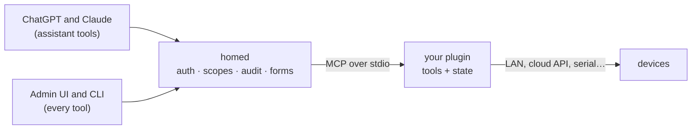
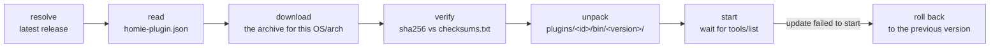

# Writing a Homie plugin

A plugin gives the hub (`homed`) one family of devices: TVs, smart plugs, a kettle, a robot vacuum. It is a separate
executable, written in any language, that speaks [MCP](https://modelcontextprotocol.io) over stdio. The hub starts
it, lists its tools, and calls them on behalf of the family's assistants and the admin. Plugins are never reachable
from the network: only the hub talks to them.

This guide has three parts:

1. **[Tutorial](#tutorial-a-smart-plug-plugin-in-15-minutes)** — build, test, release and install a real plugin in
   about 15 minutes, starting from the [template](../templates/plugin).
2. **[Writing good tools](#writing-good-tools)** — what makes a tool work well by voice.
3. **[Protocol reference](#protocol-reference)** — the contract between the hub and a plugin. Everything a plugin may
   rely on is written there.

Go authors get a small helper package, [`github.com/devXpro/homie/pluginkit`](../pluginkit/pluginkit.go), built on
the official [go-sdk](https://github.com/modelcontextprotocol/go-sdk) v1.8.0. The first real plugin,
[homie-tv](https://github.com/devXpro/homie-tv), is a good second read after the tutorial.

## The idea



A plugin is a **set of tools**. Each tool has a name, an English description written for a language model, and a JSON
Schema for its arguments. Three kinds matter:

| Kind | Who sees it | Example | Marked with |
|---|---|---|---|
| **Assistant tool** | ChatGPT, Claude, the admin, the CLI | `tv_power_on`, `plug_switch` | nothing (the default) |
| **Admin tool** | only the admin and the CLI | `tv_pair`, `plug_add` | `pluginkit.Admin` |
| **Inventory tool** | everyone; the admin draws the device list from it | `tv_list`, `plug_list` | `pluginkit.Inventory` |

The hub does the rest for you:

- **Access.** It checks every caller's key, shows each person only the plugins they may use, rate-limits and writes the
  audit log. Your plugin never sees a key.
- **Admin UI.** It renders every admin tool as a form generated from its JSON Schema, shows a device picker for
  arguments marked `x-homie-ref`, shows your progress messages while a tool runs, and lists your inventory as the
  plugin's devices — in English and in any language you add.
- **Lifecycle.** It starts your plugin, restarts it after a crash with backoff, stops it cleanly, keeps its log, and
  gives it a private data directory.
- **Distribution.** It installs and updates your plugin from GitHub releases, verifies checksums and rolls back an
  update that does not start.

So a plugin is small: device code, a handful of tools, and a JSON file of state.

---

## Tutorial: a smart-plug plugin in 15 minutes

We will build `homie-plug`: switch [Shelly](https://shelly.cloud) Gen2+ smart plugs on and off by voice, through their
local HTTP API (no cloud). The finished code is [`templates/plugin`](../templates/plugin); this tutorial walks through
it. You do not need a Shelly plug: the tests use a fake one.

**You need:** Go 1.26 (the `go` command fetches the exact toolchain, go1.26.11, by itself),
[golangci-lint](https://golangci-lint.run) v2 for linting, and `homed` to try it (built from this repo or installed,
see [INSTALL-HOME.md](INSTALL-HOME.md)).

### 1. Start from the template

```sh
git clone https://github.com/devXpro/homie.git
cp -R homie/templates/plugin ~/src/homie-plug
cd ~/src/homie-plug
go mod edit -module github.com/YOUR-NAME/homie-plug
go mod edit -dropreplace github.com/devXpro/homie
go get github.com/devXpro/homie@latest
go mod tidy
go test ./...
```

The template's `go.mod` has `replace github.com/devXpro/homie => ../..`, which only works inside the homie
repository; the second `go mod edit` removes it. What you get:

```
homie-plug/
  main.go               identity and the three tools
  plug.go               the device client (Shelly) and the store (plugs.json)
  main_test.go          an in-memory MCP client against a fake plug
  homie-plugin.json  the manifest the hub's installer reads
  .goreleaser.yaml      release archives named the way the hub expects
  .github/workflows/    ci.yml (lint + test), release.yml (GoReleaser on a tag)
  .golangci.yml  LICENSE  README.md
```

### 2. Give it an identity

```go
s := pluginkit.New(pluginkit.Plugin{
	ID: "plug", Name: "homie-plug", Title: "Smart plugs", Version: version, Instructions: instructions,
})
```

- `ID` is the prefix of every tool name: `plug_list`, `plug_switch`. Lowercase, 2–16 characters
  (`^[a-z][a-z0-9]{1,15}$`). `pluginkit.New` panics on a bad one: it is a programming error.
- `Name` is the binary and repository name; `Title` is what people see in the admin.
- `Instructions` is optional, short English guidance the hub merges into what the model reads:
  `"Smart plugs switch lamps and other appliances. Switch a plug only when the user asks."`
- `version` is a `var` the release sets with `-ldflags "-X main.version=…"`.

### 3. Talk to the device

Keep the device protocol behind a small interface, so tests can swap it and so a second brand fits later:

```go
type Device interface {
	Info(ctx context.Context, host string) (model string, err error)
	State(ctx context.Context, host string) (on bool, err error)
	Set(ctx context.Context, host string, on bool) error
}
```

`Shelly` implements it with three local RPC calls: `GET /rpc/Shelly.GetDeviceInfo`, `GET /rpc/Switch.GetStatus?id=0`
and `GET /rpc/Switch.Set?id=0&on=true`. Two habits worth copying from it: a short HTTP timeout (a tool should fail in
seconds, not hang), and **no redirects**, so a request never leaves the device's address.

### 4. Keep state in the data dir

```go
dir, err := pluginkit.DataDir() // HOMIE_DATA_DIR under the hub, ./data in development
```

The hub gives every plugin a private, persistent directory (`<hub data dir>/plugins/<id>/data`, mode `0700`) and runs
the plugin with it as the working directory. The template keeps a list of plugs in `plugs.json` there, written
atomically (a temp file, then a rename). Pairing keys and tokens belong here too — and nowhere else: never in logs,
never in tool results.

### 5. The inventory tool

```go
mcp.AddTool(s, pluginkit.I18n(pluginkit.Inventory(&mcp.Tool{
	Name:        "plug_list",
	Title:       "List plugs",
	Description: "Lists the smart plugs at home with their id, name and state (on, off or offline).",
	InputSchema: object(nil),
	Annotations: &mcp.ToolAnnotations{ReadOnlyHint: true},
}), "ru", pluginkit.Text{Title: "Розетки", Description: "Все умные розетки дома и включены ли они."}), h.list)
```

It returns `{"items":[{"id","name","subtitle","state"}]}` as structured content. The admin turns it into the plugin's
device list (`subtitle` is the grey second line, `state` the dot: `on`, `off`, `offline`, `unknown`, `paired`,
`unpaired`). Probe the state cheaply and with a short timeout — the template gives each plug two seconds — because the
list is loaded every time someone opens the page.

### 6. The assistant tool

```go
mcp.AddTool(s, pluginkit.I18n(&mcp.Tool{
	Name:        "plug_switch",
	Title:       "Switch a plug",
	Description: "Turns a smart plug on or off. Leave out plug when only one plug is set up.",
	InputSchema: object(map[string]any{
		"plug": pluginkit.InventoryRef(map[string]any{
			"type":        "string",
			"description": "The plug's id or name, as plug_list shows it.",
		}),
		"on": map[string]any{"type": "boolean", "description": "true to turn on, false to turn off."},
	}, "on"),
	Annotations: &mcp.ToolAnnotations{DestructiveHint: new(false), IdempotentHint: true},
}, "ru", pluginkit.Text{
	Title:       "Включить или выключить",
	Description: "Включает или выключает розетку.",
	Properties:  map[string]string{"plug": "Розетка", "on": "Включить"},
}), h.switchPlug)
```

Four details make it work by voice:

- **The device argument is optional** when only one plug exists, and accepts an id *or* a name. "Turn on the lamp"
  must not need a follow-up question.
- **`InventoryRef`** marks `plug` as a device id from `plug_list`, so the admin shows a picker instead of a text field.
- **Annotations are honest.** Switching changes something (`readOnlyHint` stays false) but is safe to repeat
  (`idempotentHint: true`) and not destructive.
- **Failures are results, not errors.** When the plug does not answer, return `isError: true` with a sentence that
  says what to do:

  ```go
  return failure(p.Name + " did not answer. Check that it is plugged in and on the home Wi-Fi."), nil, nil
  ```

  A Go `error` (or a JSON-RPC error) means "could not run at all": bad arguments, a broken store.

Successful results carry a short human sentence — `"Desk lamp is on."` — both as text content and as `message` in the
structured content:

```go
func result(text string, structured map[string]any) *mcp.CallToolResult {
	structured["message"] = text
	return &mcp.CallToolResult{Content: []mcp.Content{&mcp.TextContent{Text: text}}, StructuredContent: structured}
}
```

The `message` is a good habit: a client may read either the text or the structured content, so the sentence is in both.

### 7. The admin tool, with progress

```go
mcp.AddTool(s, pluginkit.I18n(pluginkit.Admin(pluginkit.Timeout(&mcp.Tool{
	Name:        "plug_add",
	Title:       "Add a plug",
	Description: "Adds the Shelly Gen2+ plug at a LAN address and reads its model. The plug must be powered.",
	InputSchema: object(map[string]any{
		"host": map[string]any{"type": "string", "description": "The plug's IPv4 address, e.g. 192.0.2.30."},
		"name": map[string]any{"type": "string", "description": "What people call it, e.g. Desk lamp."},
	}, "host"),
	Annotations: &mcp.ToolAnnotations{DestructiveHint: new(false)},
}, 30*time.Second)), "ru", pluginkit.Text{
	Title:       "Добавить розетку",
	Description: "Умная розетка Shelly по её IP-адресу.",
	Properties:  map[string]string{"host": "IP-адрес", "name": "Название"},
}), h.add)
```

- `pluginkit.Admin` hides it from the assistants: setting things up is not a voice job.
- `pluginkit.Timeout` raises the hub's call timeout (default 30 s, maximum 300 s). Pairing flows that wait for a
  button press use 180 s.
- `pluginkit.I18n` adds the Russian title, description and field labels the admin shows. Assistants always get the
  English texts.
- The helpers return the same tool, so they chain in any order.

Inside the handler, report what is happening:

```go
_ = pluginkit.Progress(ctx, req, 1, 2, "Checking the plug at "+host,
	map[string]string{"ru": "Проверяем розетку " + host})
```

The admin shows the latest message under a spinner (homie-tv shows "Press OK on the TV remote" this way). When an
assistant calls, there is no progress token and `Progress` does nothing, so you can call it unconditionally.

### 8. Serve

```go
ctx, stop := signal.NotifyContext(context.Background(), os.Interrupt, syscall.SIGTERM)
err := pluginkit.Serve(ctx, s) // MCP on stdin/stdout until the hub closes stdin or sends SIGTERM
stop()
```

**stdout belongs to the protocol.** Log to stderr (`slog` does by default; `pluginkit.New` sets its server logger to
stderr at `HOMIE_LOG_LEVEL`). The hub keeps the last 1000 lines and writes them to `logs/<id>.log`; the admin shows
them under the plugin's *Module log*.

### 9. Test

`main_test.go` connects an in-memory MCP client to the server, exactly as the hub would over stdio, with a fake Shelly
behind `httptest`:

```go
srvT, cliT := mcp.NewInMemoryTransports()
ss, err := newServer(NewStore(t.TempDir()), dev).Connect(ctx, srvT, nil)
cs, err := mcp.NewClient(&mcp.Implementation{Name: "test", Version: "0"}, &mcp.ClientOptions{
	ProgressNotificationHandler: func(_ context.Context, req *mcp.ProgressNotificationClientRequest) {
		progress <- req.Params
	},
}).Connect(ctx, cliT, nil)
```

It checks the tool list and its `_meta` (audience, inventory role, translations), a full add → switch → list round,
progress reports (send a progress token with `params.SetProgressToken("t1")`, as the admin does), and the failure
texts. Run:

```sh
go test -race ./...
golangci-lint run ./...
```

### 10. Run it under the hub

Use a scratch data dir, never your real one:

```sh
go build -o bin/homie-plug .
W=/tmp/plug-dev
homed plugin add --data-dir $W/data --id plug -- "$PWD/bin/homie-plug" serve
homed run --data-dir $W/data --listen 127.0.0.1:8080 --setup-listen 127.0.0.1:8090 \
  --dev-origin http://localhost:8080 &
homed tool list --data-dir $W/data
homed tool call --data-dir $W/data plug_add '{"host":"192.0.2.30","name":"Desk lamp"}'
homed tool call --data-dir $W/data plug_switch '{"on":true}'
```

Flags of `homed plugin add` go **before** `--`; everything after it is your command. `homed tool call` prints progress
to stderr while the tool runs, then the text and the structured result; a tool that ran and failed exits with status 1.
`--dev-origin` runs the hub without a tunnel, with passkeys for `localhost`, so the admin works at
`http://localhost:8080/` after `homed admin setup-link --data-dir $W/data`. More in [DEV.md](DEV.md).

### 11. Release

```sh
git tag v0.1.0
git push origin v0.1.0
```

`release.yml` runs GoReleaser, which publishes exactly what the hub's installer looks for:

```
homie-plug_0.1.0_darwin_amd64.tar.gz
homie-plug_0.1.0_darwin_arm64.tar.gz
homie-plug_0.1.0_linux_amd64.tar.gz
homie-plug_0.1.0_linux_arm64.tar.gz
homie-plug_0.1.0_linux_armv7.tar.gz
checksums.txt
homie-plugin.json
```

### 12. Install it from the admin

Open `https://<your host>/` → **Devices** → **Add devices** → **Another module from GitHub**, type
`YOUR-NAME/homie-plug`, **Find**. The admin shows the title, version, description and homepage from your manifest. Tap
**Install** (and confirm with Face ID or Touch ID when asked). The plugin appears under Devices; run *Add a plug* from its
**Actions**, and say "turn on the desk lamp" to ChatGPT or Claude.

A new tool or a changed description reaches an assistant in a new chat (see
[USING.md](USING.md#when-tools-change)).

That is the whole loop. The rest of this page is reference.

---

## Writing good tools

**Design for one sentence.** Each assistant tool should map to something a person says: "turn on the TV", "volume
twenty", "switch to HDMI 2". Prefer `tv_set_volume(percent)` over a generic `tv_command(name, args)`.

**Names.** `<id>_<verb>[_<object>]`, lowercase: `tv_power_on`, `plug_switch`, `kettle_boil`. The model reads them, so
make them obvious.

**Descriptions are prompts.** English, one or two sentences, for a model: what it does, units and ranges, and when an
argument may be left out. "Sets the volume of a TV's own speakers, in percent from 0 (silent) to 100 (loudest)." Put
limits in the schema too (`minimum`, `maximum`, `enum`): the hub validates arguments against it before calling you.

**Device arguments.** Optional when there is one device; accept an id or a name; on an ambiguous or unknown value
return `isError` listing the choices ("Say which plug: Desk lamp (plug), Kettle (plug-2).").

**Results.** One short English sentence that the assistant can repeat: "Living room TV is on." Put details in the
structured content, plus the same sentence as `message`. No secrets, no raw device dumps.

**Errors say what to do.** "The TV did not wake up. Turn on Mobile TV On in the TV settings." beats "timeout". Use
`isError: true` for anything the user can fix; reserve Go errors for bugs.

**Annotations.** `readOnlyHint: true` on every tool that changes nothing (assistants treat such tools as safe to call);
`idempotentHint` when a repeat is harmless; `destructiveHint: true` when something is deleted or forgotten.

**Admin tools are for setup.** Discovery, adding, pairing, renaming and removing devices belong in admin tools. Keep
the assistant's list short: every tool costs the model attention.

**Wait sensibly.** If an action takes time (a TV waking up), wait inside the tool until it is done or clearly failed,
within its timeout, and say which. Respect context cancellation: the hub cancels when its timeout expires.

**Translate for people.** `I18n` texts are for a phone's settings screen: "Подключить телевизор", not "Выполнить
сопряжение устройства".

## Testing

- **Unit tests through MCP.** Connect `mcp.NewInMemoryTransports()` as in step 9 and call tools by name. This tests
  the schema, the `_meta` and the results the hub will really see. Fake the device behind an interface (an
  `httptest.Server`, a fake WebSocket server, a fake UDP listener); no sleeps where a channel will do.
- **Check the contract.** `pluginkit.CheckToolName(id, name)` is the hub's own name check. Assert `_meta`:
  `tool.Meta[pluginkit.MetaAudience]`, `MetaRole`, `MetaTimeout`, `MetaI18n`.
- **Live tests** that need the LAN or a real device go behind a build tag (`//go:build integration`) and stay
  read-only by default. homie-tv's `make test-live` is an example.
- **Under the hub:** step 10 above, with `homed tool call`.

## Releasing

The hub installs plugins from GitHub releases. A release is a plugin release when it carries:

| Asset | Content |
|---|---|
| `<binary>_<version>_<os>_<arch>.tar.gz` | one per platform; `<version>` is the tag without the `v` (`0.1.0` for `v0.1.0`); 32-bit ARM is looked up as `armv7`, then `armv6`, then `arm`. The archive may be flat or wrap everything in one directory; it must contain the file named by `binary`. |
| `checksums.txt` | GoReleaser format: `<sha256>  <archive name>` per line. An archive without a matching line is refused. |
| `homie-plugin.json` | the manifest below |

Platforms the hub runs on: `darwin_amd64`, `darwin_arm64`, `linux_amd64`, `linux_arm64` and `linux_armv7` (Raspberry
Pi OS 32-bit). Build them all; a missing one makes the admin say "There's no build of this module for this computer".

### The manifest: `homie-plugin.json`

```json
{
  "id": "plug",
  "title": "Smart plugs",
  "description": "Switch Shelly Gen2+ smart plugs on and off by voice.",
  "binary": "homie-plug",
  "args": ["serve"],
  "minHubVersion": "0.1.0",
  "homepage": "https://github.com/YOUR-NAME/homie-plug"
}
```

| Field | Rule |
|---|---|
| `id` | required; `^[a-z][a-z0-9]{1,15}$`; the prefix of every tool name; installing a second plugin with the same id is refused |
| `title` | the name in the admin; defaults to `id` |
| `description` | one line for the install screen |
| `binary` | required; a plain file name (no `/`), the executable inside the archive |
| `args` | defaults to `["serve"]` |
| `minHubVersion` | optional semver; an older hub refuses the install ("This needs a newer Homie") |
| `homepage` | optional; shown only when it is an `https` URL |

The manifest holds no version, so it is a static file in the repository, uploaded as is
(`release.extra_files` in `.goreleaser.yaml`).

### What the hub does with it



Unpacking refuses absolute paths, `..`, links of any kind, devices and oversized archives, and normalizes file modes.
Note that `checksums.txt` comes from the same release: it guards against corruption, not against a compromised
repository. The owner trusts the repository they install from — and the plugin runs with the hub's full rights (see
[SECURITY.md](SECURITY.md)).

### Installing without a release

For your own builds, add a local executable with the CLI on the home box:

```sh
homed plugin add --id plug -- /usr/local/bin/homie-plug serve
homed plugin list
homed plugin remove plug              # --delete-data also deletes its data dir
```

## Other languages

Anything that speaks MCP over stdio works: the official [Python](https://github.com/modelcontextprotocol/python-sdk)
and [TypeScript](https://github.com/modelcontextprotocol/typescript-sdk) SDKs, or any other. Follow the
[protocol reference](#protocol-reference) by hand: set the `_meta` keys on your tools, read `HOMIE_DATA_DIR`, never
print to stdout, and exit on EOF or SIGTERM. For the installer, ship a self-contained executable per platform in the
archive layout above (a script with an interpreter the home box may not have is fragile).

---

## Protocol reference

This is the contract. A plugin may rely on everything here; the hub enforces it.

### Process

- The hub runs `<command> [args…]`; the default argument list is `["serve"]`.
- The working directory is the plugin's data directory.
- The environment is minimal: `PATH`, `HOME`, `LANG` and `TZ` from the hub (when set), plus:

  | Variable | Meaning |
  |---|---|
  | `HOMIE_PLUGIN_ID` | the plugin id, e.g. `tv` |
  | `HOMIE_DATA_DIR` | persistent per-plugin directory, mode 0700; keep your state here |
  | `HOMIE_LOG_LEVEL` | `debug`, `info`, `warn` or `error` |
  | `HOMIE_HUB_VERSION` | the hub's version |

  Nothing else is passed through, so a plugin never sees the hub's secrets in its environment.
- stdin and stdout carry MCP: newline-delimited JSON-RPC. Use the protocol version your SDK negotiates with go-sdk
  v1.8.0; both the 2026-07-28 protocol (`server/discover`) and the older `initialize` handshake (2025-11-25 and
  earlier) work.
- **stderr is your log.** The hub keeps the last 1000 lines in memory and writes everything to
  `<hub data dir>/logs/<id>.log` (rotated at 5 MB, three files). Never write logs to stdout: it would break the protocol.

### Identity

- Plugin id: `^[a-z][a-z0-9]{1,15}$`, e.g. `tv`, `kettle`. It must be the prefix of every tool name. For a local
  plugin the person adding it chooses the id (`homed plugin add --id`); for a release it is the manifest's `id`.
- In the `initialize` (or `server/discover`) result:
  - `serverInfo.name`: the repo or binary name, e.g. `homie-tv`;
  - `serverInfo.title`: a human name, e.g. `TV`;
  - `serverInfo.version`: semver.
- Optional `instructions`: short English guidance for the model. The hub merges them into its own instructions.

### Tools

- Name: `^<id>_[a-z][a-z0-9_]*$`, e.g. `tv_power_on`. The hub skips any other name and logs a warning. A tool whose
  schema the MCP server refuses is skipped too; the plugin's other tools keep working.
- `description`: English, written for an LLM, one or two sentences, with units and ranges stated
  ("Sets the volume, 0 to 100 percent.").
- `inputSchema` is a JSON Schema object; `outputSchema` is optional.
- Annotations follow MCP: `readOnlyHint: true` on every tool that changes nothing; `destructiveHint` and
  `idempotentHint` where they apply.
- Tool `_meta` keys the hub understands (all optional):

  | Key | Value | Effect |
  |---|---|---|
  | `homie/audience` | `"admin"` | hidden from assistants; only the admin UI and the `homed` CLI see it. Default `"assistant"`. Any other value is treated as `"admin"`. |
  | `homie/timeout` | seconds (number) | the hub-side call timeout. Default 30, maximum 300 (larger values are capped). Pairing flows use 180. |
  | `homie/role` | `"inventory"` | marks the device list. Only on a `readOnlyHint` tool, at most one per plugin (the hub keeps the first by name). |
  | `homie/i18n` | `{"<lang>": {"title", "description", "properties": {"<input property>": "<label>"}}}` | translated texts for the admin UI; see below. |

  The inventory tool returns `{"items":[{"id","name","subtitle"?,"state"?}]}` as `structuredContent`, where `state` is
  one of `on|off|offline|unknown|paired|unpaired`. The admin renders it as the device list.

#### Translations (`homie/i18n`)

The admin UI is in Russian and English. A tool can carry its title, description and input labels in other languages:

```json
"_meta": {"homie/i18n": {"ru": {"title": "Громкость", "description": "Задаёт громкость динамиков, 0–100 %.",
                                   "properties": {"tv": "Телевизор", "percent": "Громкость, %"}}}}
```

- Keys are language tags (`ru`, `pt-BR`); every field is optional.
- Write for a person, not a model: short, plain words, like a phone's settings screen ("Подключить телевизор", not
  "Выполнить сопряжение устройства").
- Only the admin UI uses them. Assistants always get the English `title` and `description`, so keep those complete.
- The hub is lenient: a malformed language or field is skipped with a warning in the hub log, the rest is kept.

#### Device arguments (`x-homie-ref`)

An input property whose value is a device id from the plugin's inventory tool says so in its schema:

```json
"tv": {"type": "string", "description": "The TV's id or name, as tv_list shows it.", "x-homie-ref": "inventory"}
```

The admin then shows a device picker for it instead of a text field, and opens the tool from that device's screen.
Without the keyword the hub guesses (a required string property named like the plugin id, `device` or `item`).

### Calls

- Every `tools/call` carries request `_meta` `{"homie/caller":"<person name>","homie/via":"chatgpt|claude|admin|cli"}`.
  Log it if useful; **never trust it for security**.
- The hub validates the arguments against `inputSchema` before an admin or CLI call reaches the plugin.
- Results:
  - text content: short, English, human ("Living room TV is on.");
  - optional `structuredContent`; repeat the sentence in it, e.g. as `message`;
  - a tool that ran but failed (device unreachable, not paired) returns `isError: true` with a text that says what to
    do ("The TV did not wake up. Turn on Mobile TV On in the TV settings."); the assistant gets that text as a failed
    result, and the admin API answers `422 tool_failed` with it;
  - a JSON-RPC error means the call could not run at all: bad arguments, an internal error.
- When the hub's timeout expires it sends `notifications/cancelled`; stop the work when your context is cancelled.

#### Progress

A long-running tool (pairing, a network search) can tell the person what is happening. When the admin or the CLI runs
a tool, the hub sends a `progressToken` in the request `_meta`; the tool may then send MCP `notifications/progress`
for it:

```json
{"method": "notifications/progress", "params": {"progressToken": "homie-7", "progress": 1,
  "message": "Press OK on the TV remote", "_meta": {"homie/i18n": {"ru": "Нажмите OK на пульте телевизора"}}}}
```

- `progress` grows with every report; `total` is optional (omit it when unknown).
- `message` is short English for a person; the notification `_meta` `homie/i18n` carries its translations.
- Calls from assistants carry no token: send nothing then (`pluginkit.Progress` does that check for you).
- The admin shows the latest report until the result arrives. A report sent together with the result may be dropped,
  so put the outcome in the result, not in a last report.

### Lifecycle

- The hub calls `tools/list` after the handshake and again on `notifications/tools/list_changed`, so a plugin can add
  or remove tools at run time (go-sdk sends the notification by itself on `AddTool` and `RemoveTools`).
- A crashed plugin is restarted with backoff 1, 2, 4… up to 60 s. After 5 crashes within 5 minutes its state becomes
  `failing` and it is retried every 5 minutes. A run that stays up for a minute resets both.
- While a plugin is down, the hub keeps listing its last known tools; calls to them fail with "plugin unavailable"
  until it is back.
- Shutdown: the hub closes the session (your stdin reaches EOF), sends SIGTERM, and SIGKILL 5 s later. Exit promptly on
  either.

### Trust

A plugin runs as the same OS user as `homed` and is fully trusted: it can read everything that user can. The data dir
is for tidiness, not a sandbox. Plugins never receive callers' keys and are not reachable from the network through the
hub. See [SECURITY.md](SECURITY.md#plugins).

### pluginkit reference

| Function | Does |
|---|---|
| `New(Plugin) *mcp.Server` | a go-sdk server with `serverInfo` and `instructions` set and a stderr logger at `HOMIE_LOG_LEVEL`; panics on an invalid id |
| `Admin(t)` | sets `_meta "homie/audience": "admin"` |
| `Timeout(t, d)` | sets `_meta "homie/timeout"` to `d` in whole seconds, rounded up |
| `Inventory(t)` | sets `_meta "homie/role": "inventory"` (add `ReadOnlyHint: true` yourself) |
| `I18n(t, lang, Text{Title, Description, Properties})` | adds one language to `_meta "homie/i18n"`; call once per language |
| `InventoryRef(prop)` | sets `"x-homie-ref": "inventory"` on a `map[string]any` property schema (for a `*jsonschema.Schema`: `Extra[pluginkit.SchemaRef] = pluginkit.RefInventory`) |
| `Progress(ctx, req, progress, total, message, i18n)` | sends `notifications/progress` when the hub asked for it; a no-op otherwise |
| `DataDir()` | `HOMIE_DATA_DIR`, or `./data` in development; created with mode 0700; absolute |
| `Caller(req)` | the person and surface from the request `_meta`; empty outside the hub |
| `Serve(ctx, s)` | MCP over stdio until ctx is done or stdin closes; both return nil |
| `CheckToolName(id, tool)` | the tool name rule; the hub uses the same function |

The `Meta*`, `Env*`, `SchemaRef` and `RefInventory` constants name the protocol keys and variables above.

On the hub side, `plugins.WithProgress(ctx, func(plugins.Progress))` makes `Host.Call` send the progress token and
pass every report (progress, total, message and its translations) to the callback while the call runs.

### A plugin in one file

The smallest useful shape, for reference ([`pluginkit/example`](../pluginkit/example/main.go) is a runnable one):

```go
package main

import (
	"context"
	"log/slog"
	"os"
	"os/signal"
	"syscall"
	"time"

	"github.com/devXpro/homie/pluginkit"
	"github.com/modelcontextprotocol/go-sdk/mcp"
)

type boilIn struct {
	Celsius int `json:"celsius" jsonschema:"target temperature, 40 to 100 °C"`
}

type pairIn struct {
	Kettle string `json:"kettle"`
}

func main() {
	s := pluginkit.New(pluginkit.Plugin{
		ID: "kettle", Name: "homie-kettle", Title: "Kettle", Version: "0.1.0",
		Instructions: "Boil water only when the user asks for it.",
	})

	mcp.AddTool(s, &mcp.Tool{
		Name:        "kettle_boil",
		Description: "Heats the kettle to the given temperature, 40 to 100 °C.",
	}, func(ctx context.Context, req *mcp.CallToolRequest, in boilIn) (*mcp.CallToolResult, any, error) {
		person, via := pluginkit.Caller(req) // for the log only
		slog.Info("boil", "celsius", in.Celsius, "caller", person, "via", via)
		// ... talk to the kettle; on failure return IsError with a hint:
		// return &mcp.CallToolResult{IsError: true, Content: []mcp.Content{&mcp.TextContent{
		// 	Text: "The kettle is offline. Check that it is plugged in."}}}, nil, nil
		return &mcp.CallToolResult{Content: []mcp.Content{&mcp.TextContent{Text: "The kettle is heating."}}}, nil, nil
	})

	// Admin-only, with a longer timeout, Russian texts and a device argument; the helpers chain.
	mcp.AddTool(s, pluginkit.I18n(pluginkit.Admin(pluginkit.Timeout(&mcp.Tool{
		Name:        "kettle_pair",
		Description: "Pairs a kettle. Hold its button for 5 seconds first.",
		InputSchema: map[string]any{"type": "object", "required": []string{"kettle"}, "properties": map[string]any{
			"kettle": pluginkit.InventoryRef(map[string]any{"type": "string", "description": "The kettle's id."}),
		}},
	}, 3*time.Minute)), "ru", pluginkit.Text{
		Title:       "Подключить чайник",
		Description: "Зажмите кнопку на чайнике на 5 секунд.",
		Properties:  map[string]string{"kettle": "Чайник"},
	}), func(ctx context.Context, req *mcp.CallToolRequest, in pairIn) (*mcp.CallToolResult, any, error) {
		_ = pluginkit.Progress(ctx, req, 1, 0, "Hold the kettle button", map[string]string{"ru": "Зажмите кнопку на чайнике"})
		dir, err := pluginkit.DataDir() // HOMIE_DATA_DIR, or ./data in development
		if err != nil {
			return nil, nil, err
		}
		_ = dir // ... pair in.Kettle and store the pairing here
		return &mcp.CallToolResult{Content: []mcp.Content{&mcp.TextContent{Text: "Kettle paired."}}}, nil, nil
	})

	ctx, stop := signal.NotifyContext(context.Background(), os.Interrupt, syscall.SIGTERM)
	err := pluginkit.Serve(ctx, s) // returns nil on SIGTERM or when the hub closes stdin
	stop()
	if err != nil {
		slog.Error("serve", "err", err)
		os.Exit(1)
	}
}
```

Try the bundled example under a hub:

```sh
go build -o bin/homie-echo ./pluginkit/example
homed plugin add --id echo -- "$PWD/bin/homie-echo" serve
homed tool list
homed tool call echo_say '{"text":"hello"}'
```

### Release assets

- GoReleaser archives `<binary>_<version>_<os>_<arch>.tar.gz` plus `checksums.txt`.
- `homie-plugin.json`: `{"id","title","description","binary","args":["serve"],"minHubVersion","homepage"}`.
- Details and field rules: [Releasing](#releasing).
