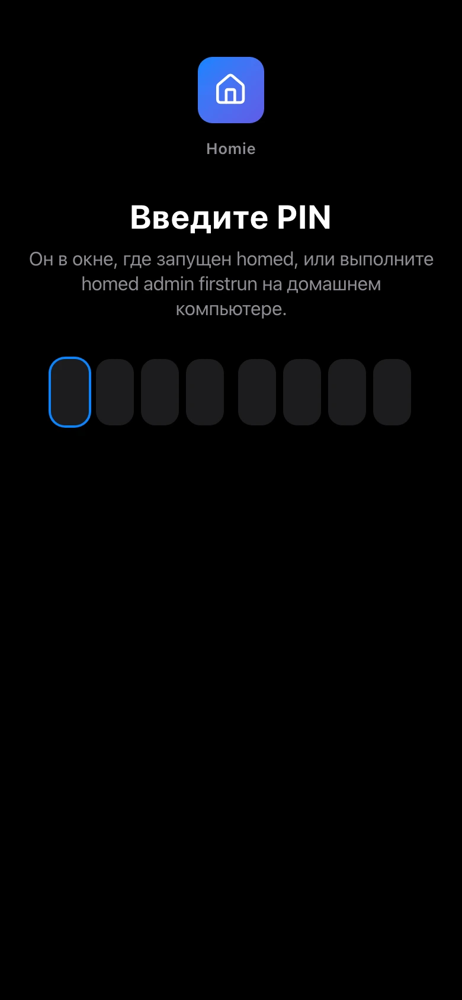
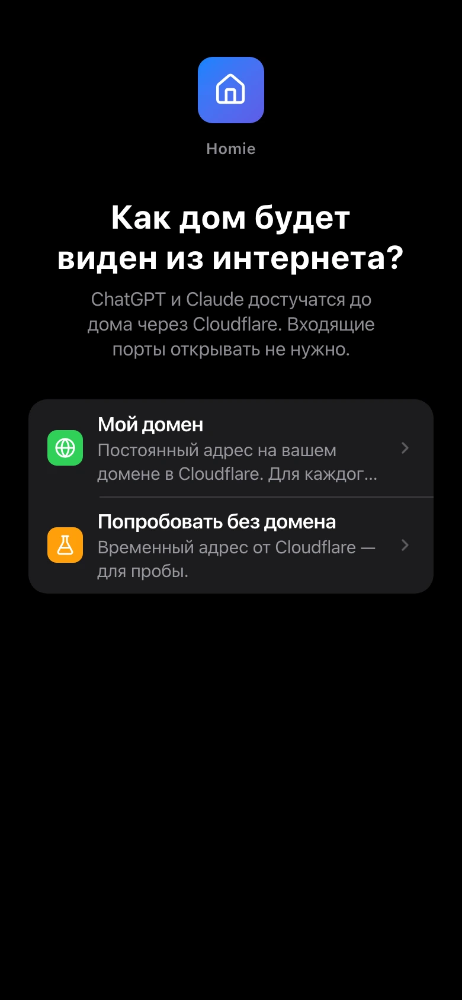
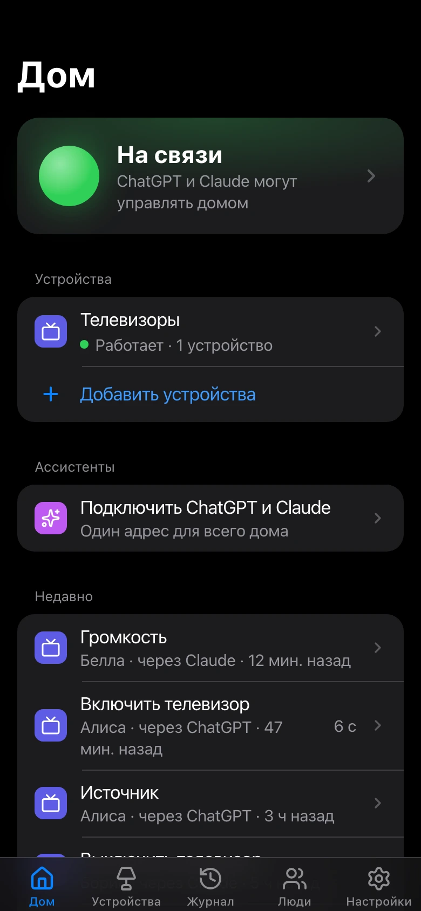
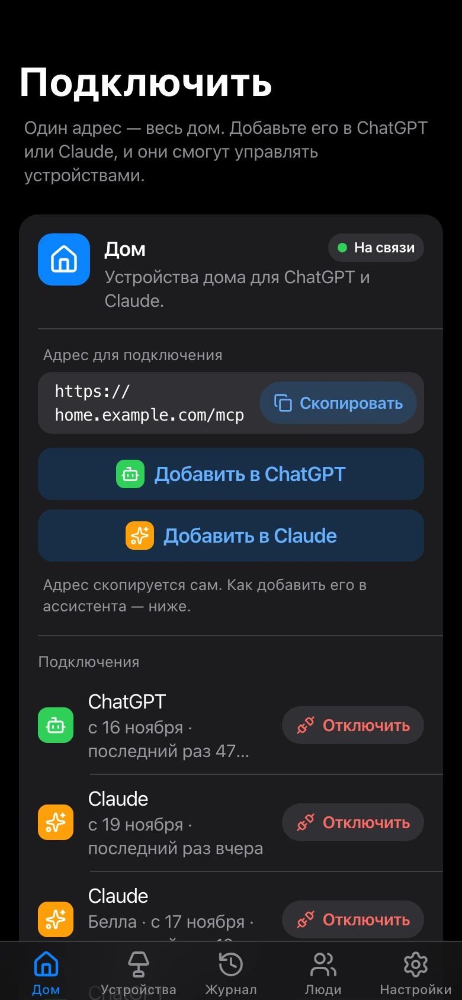

# Quick start

From nothing to "turn on the TV" by voice. You need a box at home that stays on (a Mac, a Raspberry Pi, a Linux box
or a NAS), a ChatGPT or Claude account, and — for the permanent setup — a **domain whose DNS is on Cloudflare** (a free
Cloudflare account is enough). There is no server to rent.

The long versions: [INSTALL-HOME.md](INSTALL-HOME.md), [USING.md](USING.md).

## Home — 5 minutes

**1. Install the hub** with your domain (replace `home.example.com`):

```sh
# macOS
curl -fsSL https://raw.githubusercontent.com/devXpro/homie/main/install/home.sh | bash -s -- --domain home.example.com

# Raspberry Pi / Linux
curl -fsSL https://raw.githubusercontent.com/devXpro/homie/main/install/home.sh | sudo bash -s -- --domain home.example.com

# NAS / Docker on Linux (host networking is required), then connect from inside:
docker run -d --name homie --restart unless-stopped --network host -v homie:/data ghcr.io/devxpro/homie:latest
docker exec homie homed cloudflare connect home.example.com
```

The installer starts the hub as a service, installs `cloudflared`, and prints a **Cloudflare login link**. Open it,
sign in and pick the zone of your domain; Homie creates the tunnel and the DNS record `home.example.com` for you.

No domain yet? Just trying it? Use `--quick-tunnel` instead of `--domain …`: a temporary `trycloudflare.com` address,
for you alone, that changes whenever the hub restarts.

**2. Create your passkey.** Over SSH or in a terminal on the home box:

```sh
homed admin setup-link        # macOS installer: "$HOME/Library/Application Support/homie/bin/homed" admin setup-link
```

Open the link it prints (once, valid 15 minutes), name your home — the name the assistants will show, e.g. «Дом» —
enter your name, and confirm with Face ID or Touch ID. You are in the admin at `https://home.example.com/`.

Prefer a browser to a terminal? The installer also prints the **first-run page**'s address and an 8-digit PIN
(`homed admin firstrun` shows them again): open it on your phone, type the PIN, connect Cloudflare there, and scan the
QR code of the setup link.

<p>
  
  
  
</p>

**3. Add the TV.** Prepare an LG webOS TV once: *LG Connect Apps* on, *Mobile TV On → Turn on via Wi-Fi* on, a fixed IP
in your router. Then in the admin: **Devices → Add devices**, the TV module under *Recommended*, **Install**; then
**Find TVs**, **Add a TV**, **Pair a TV** and press **OK** on the remote.

## ChatGPT and Claude — 2 minutes each

Open the admin's **Connect** page (**Home → Connect ChatGPT and Claude**). It shows your one address,
`https://home.example.com/mcp`, with a copy button and the steps for each assistant.



1. **ChatGPT:** add a custom connector (Apps / Connectors in its settings; custom connectors need a plan that offers
   them and, today, its developer mode), paste the address, and name it after your home. It sends you to your Homie
   to sign in with Face ID and tap **Allow**.
2. Ask in **text** first: *"Turn on the TV"*. When ChatGPT asks to run the action, choose **Always allow**; in voice
   mode there is no screen to approve on, so this one tap is required before voice.
3. **Claude:** Settings → Connectors → **Add custom connector**, the same address, **Connect**, sign in and allow. In
   a chat, turn the connector on in the tools menu.
4. Start a new chat, switch to voice, and say: **«Включи телик»**.

Next: the rest of the admin, voice tips, and inviting your family with their own passkeys, devices and a time limit —
[USING.md](USING.md). Something off? — [TROUBLESHOOTING.md](TROUBLESHOOTING.md).
