# Using Homie

A tour of the admin, then the part that matters most: connecting ChatGPT and Claude so the family can talk to the
home, and inviting the family.

The admin lives at **`https://<your host>/`** (for example `https://home.example.com/`) and works the same on a phone
(bottom tab bar) and a computer (sidebar). It speaks English and Russian, follows the system's dark or light mode, and
has no password: you sign in with a passkey — Face ID, Touch ID or your device's screen lock. The screenshots below
are from a demo home called «Дом», in Russian.

- [Sign in](#sign-in)
- [Home](#home)
- [Devices](#devices) — add a plugin, set up a TV, run actions
- [Activity](#activity)
- [People](#people) — invites with devices and a term, co-owners, extend, revoke
- [Settings](#settings) — the home's name, the connection, updates
- [Connect ChatGPT and Claude](#connect-chatgpt-and-claude) — one address, "Always allow", voice
- [When tools change](#when-tools-change)

## Sign in

Open `https://<your host>/` and tap **Sign in**. Your device asks for Face ID or Touch ID; that is all. A session
lasts up to 7 days, or 12 hours without use.

The very first passkey can only be created from the home box itself — the first-run page, or `homed admin setup-link`
in a terminal there (see [INSTALL-HOME.md](INSTALL-HOME.md#first-run-create-your-passkey)). Passkeys live in iCloud
Keychain (or your password manager), so the one you made on the Mac also works on your iPhone. A person you invite makes
their own.

## Home

<p>
  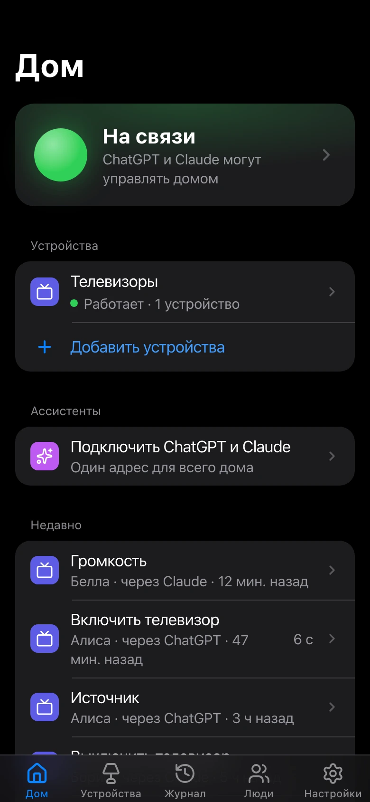
  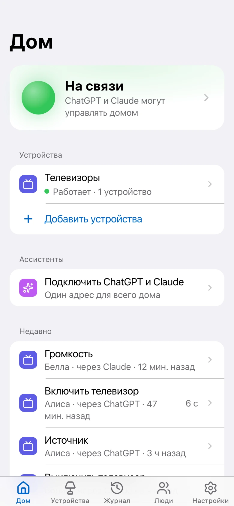
</p>

The first screen answers one question: *can ChatGPT and Claude run my home right now?*

- **The status card.** Green *ChatGPT and Claude can run your home* when the tunnel is up and the outside check
  passes. Otherwise it says what is wrong: *Connecting to Cloudflare*, *Check the internet on the home computer*,
  *Connected, but not reachable from outside*, *The connection is stopped*, or *Connect a domain on the home
  computer*. Tap it for the details (**Settings → Connection**).
- **Needs attention** appears only when something does: the tunnel is down or unreachable, a device plugin is not
  responding, an update is available, or someone ran `reset-access` on the home box (it names the program that asked).
- **Devices** lists your plugins (modules) with their state and device count.
- **Assistants** leads to the Connect page.
- **Recent** shows the last actions of the assistants: what, who, through which assistant, and how long it took. A red
  mark is a failure.

In **quick mode** a banner says the address is *for trying* and offers "Move to my own domain" (the command to run on
the home box).

## Devices

<p>
  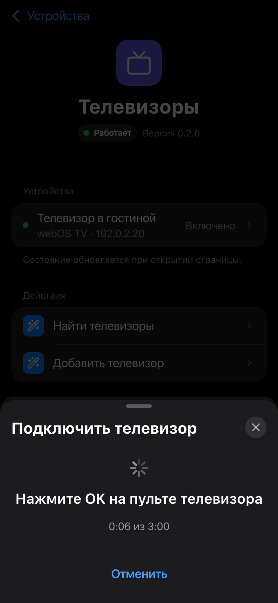
</p>

Each kind of device is a **module** (a plugin). Open one to see:

| Section | What it is |
|---|---|
| **Devices** | the module's devices and their state (on, off, offline, paired…). The state refreshes when you open the page. Tap a device for the actions that apply to it. |
| **Actions** | setup actions only you see: find, add, pair, rename, remove. Each opens a short form; long ones show progress. |
| **What it does in ChatGPT and Claude** | the commands the assistants can use, in plain words. **Try without an assistant** runs one right here. |
| **Maintenance** | version and update, the module's log, restart, turn off (the assistants stop seeing it), remove. |

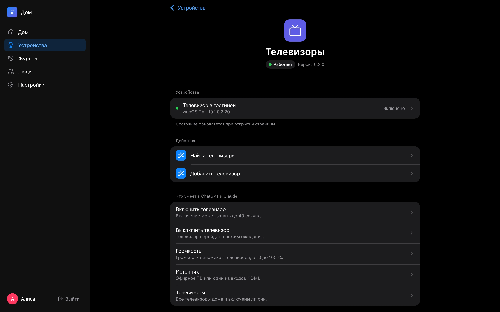

Devices are owner-only screens. A member sees the devices they may use, read-only.

### Add a plugin

**Devices → Add devices.** *Recommended* lists known modules (the TV plugin first); *Another module from GitHub* takes
any `owner/repository` that publishes Homie releases. Tap **Find**, check the name, version and source, then
**Install**. Installing, updating and removing a module ask you to confirm with Face ID or Touch ID if your last
confirmation is older than five minutes. If a new version fails to start, the previous one comes back by itself.

### Set up a TV (LG webOS)

Prepare the TV once — LG Connect Apps on, Mobile TV On → Turn on via Wi-Fi, Quick Start+ on, and a fixed IP in your
router ([details](https://github.com/devXpro/homie-tv/blob/main/docs/families/lg-webos.md#tv-setup)). Then, with the TV
switched on:

1. **Devices → Add devices**, pick the TV module under *Recommended*, **Install**.
2. Open **TVs** → **Find TVs**. The search takes up to 10 seconds and lists the TVs that answered.
3. **Add a TV**: its IP address and a name people will say, e.g. *Living room TV*. The model and MAC address are read
   from the TV.
4. Tap the TV → **Pair a TV**. The TV shows a prompt: **press OK on the remote** within two minutes. The admin shows
   the countdown.
5. **What it does → Turn TV on → Try without an assistant.** If the TV turns on, the assistants can do it too.

### Actions with progress

An action that takes a while (pairing, a network search) shows what the device is doing right now — "Press OK on
the TV remote" — and a timer. You can close the sheet; the action keeps running, a pill shows it, and a notice tells
you when it is done. **Cancel** stops it.

## Activity

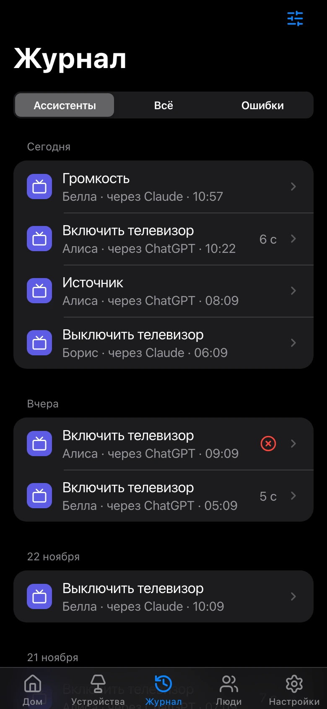

The **Журнал** tab lists every tool call: who asked, through ChatGPT, Claude, the admin or the terminal, and how it
ended. The segments switch between **Assistants**, **All** and **Failures**; **Filters** narrow it by person, device
and path. Tap an entry for the arguments (secrets are redacted), the result and how long it took. Members see only
their own calls. Sign-ins, invites, revokes and other admin actions are the *Changes and sign-ins* log under
**People**.

## People

<p>
  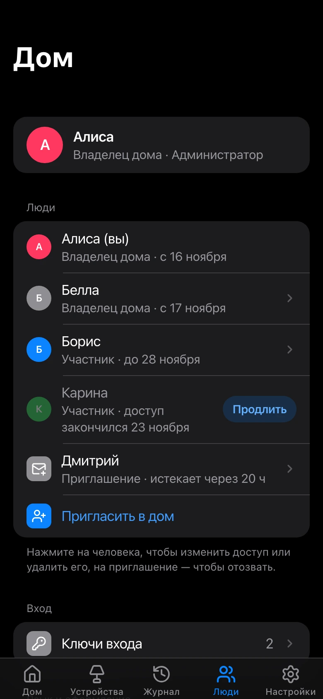
  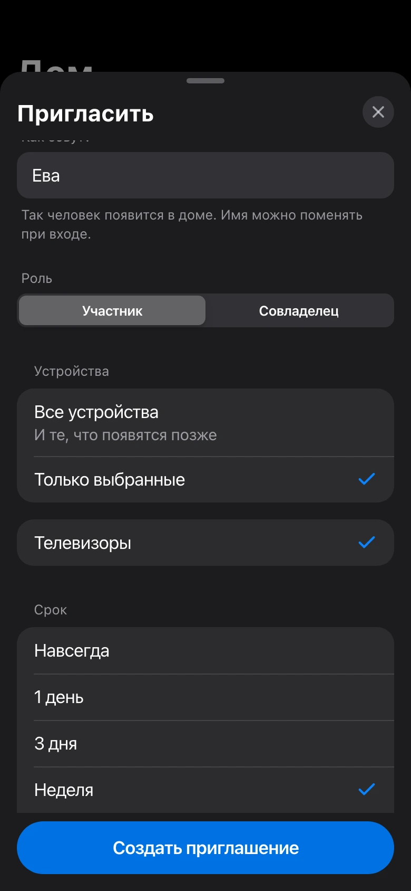
  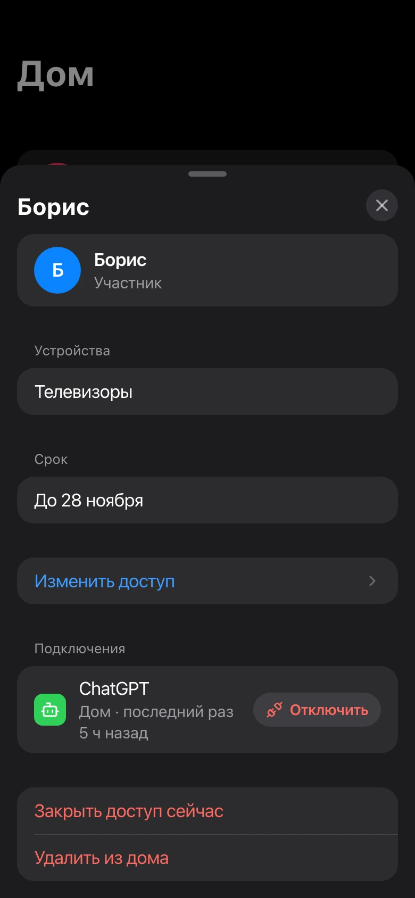
</p>

Everyone in the home signs in with **their own passkey** and connects **their own** ChatGPT or Claude account to the
same address. Nobody shares a key or a password.

### Invite a person

**People → Invite to the home.** Enter the name they will have in the home, then choose:

- **Role.** *Member*, or *Co-owner* (only the owner who set the home up sees this; see below).
- **Devices.** *All devices* (including ones added later), or *Only selected*: tick the plugins this person may use. A
  person who may use no devices sees no tools at all.
- **Term.** *Forever*, *1 day*, *3 days*, *Week*, *Month*, or *Until a date…* (at most one year). A term ends at the
  end of the chosen day, in the time zone of the device that made the invite.

Tap **Create invite**. You get a one-time link and a QR code, valid for 24 hours: send the link, or show the QR code.
The link is burned the moment someone uses it. They open it on their phone, name themselves if they want, and create
their passkey with Face ID. Then they connect ChatGPT or Claude with the same steps as below, and the Connect page of
their own admin shows the address and their devices.

Inviting people needs your own domain: in a **quick tunnel** invites are off, because a guest's passkey would die at
the next restart.

### Co-owners

A co-owner is for your partner. **Only the owner who set the home up** can invite one (role *Co-owner*). A co-owner
has every device and no term, can invite and manage members and guests, revoke their connections, and reads the log.
They cannot change or remove another owner. Changing or removing an owner, and `reset-access`, is for the first owner
alone.

### Change, extend, revoke

Tap a person to see their devices, term and **connections** (each ChatGPT or Claude connection they made).

- **Change access** — different devices, a different term. Giving *more* (more devices, a later end, no end) asks for
  Face ID once more; giving less never does.
- **Disconnect** a connection — that assistant stops working at once; the person can connect it again.
- **Close access now** — the term ends right now. The person stays in the list, their history stays, and their passkey
  is kept; they simply cannot sign in or use any connection.
- **Remove from the home** — for good: their passkeys, sessions and connections are deleted.

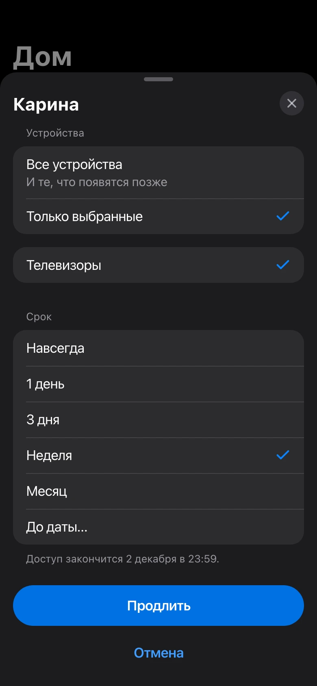

When a term runs out, the person stays in the list, greyed, with the note *access ended*, and an **Extend**
(«Продлить») button. Tap it, pick a new term (and devices), confirm with your passkey, and the same connections work
again. Nothing needs to be set up on their side.

## Settings

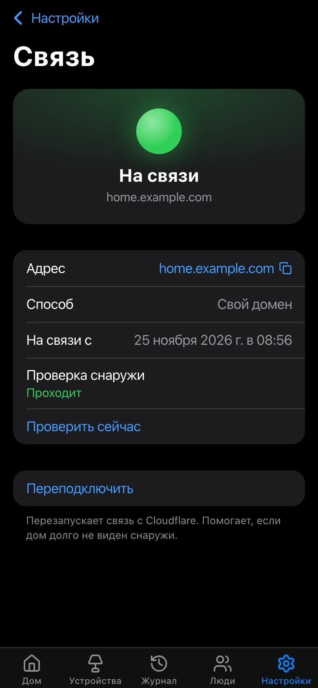

| Section | What you can do |
|---|---|
| **Home** | the home's name (the name your family sees in ChatGPT and Claude; it is also the account's name) and the admin's language |
| **Connection** | the address, how it is connected (own domain or *for trying*), connected since, the outside check (**Check now**) and **Reconnect**, which restarts the tunnel. In quick mode a reconnect gives a **new address**: after it, continue on the home box (the page tells you how) |
| **Connect ChatGPT and Claude** | the Connect page, again |
| **Updates / About** | the version, *Check for updates* and *What's new*. Updating restarts the hub; the page reloads by itself. |

Your own passkeys and the places you are signed in are under **People → Passkeys / Sessions**.

Lost a phone? On the home box: `homed admin reset-access` removes every passkey and session and prints a new setup
link. The assistants' connections are not touched; remove the ones you do not trust under **People**.

## Connect ChatGPT and Claude

The whole home is **one address**: `https://<your host>/mcp`. Add it once per assistant account. Every person who
connects signs in on your Homie with their passkey and taps **Allow**, so the assistant gets a token for that person
only, limited to their devices and term.

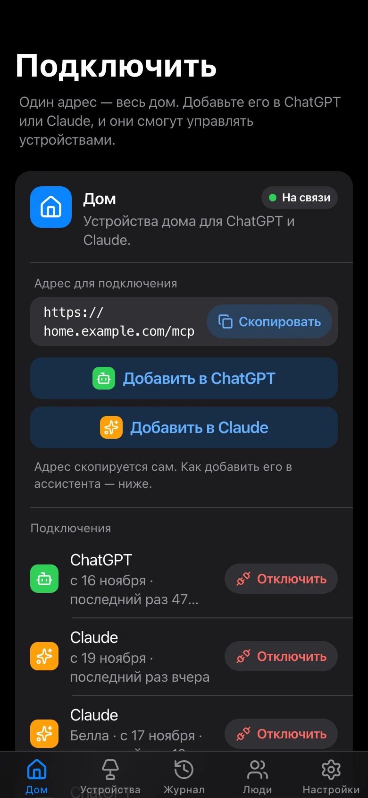

Open **Connect** (Home → *Connect ChatGPT and Claude*): copy the address, then the page's buttons and numbered steps
lead you through the assistant's own menus (they change names from time to time; the idea stays the same).

### ChatGPT

1. Open ChatGPT's connectors (apps) and add a **custom connector**. Custom connectors may need a plan that offers them
   and its developer mode.
2. Paste the address and name it after your home.
3. It opens your Homie: sign in with Face ID or Touch ID and tap **Allow**.
4. Ask for something in **text** first: "Turn on the TV". When ChatGPT asks for permission, choose **Always allow**.
5. Start a **new chat**: a chat keeps the tools it started with.

**Why "Always allow" matters.** Without it ChatGPT asks for approval on the screen before every action that changes
something. In voice mode there is no screen to approve on, so the action silently does not happen. Choose it once, in
text, before your first voice session.

### Claude

1. Open Claude's connectors, choose **Add custom connector**, paste the address and name it after your home.
2. **Connect**, sign in with Face ID or Touch ID and allow the access.
3. In a chat, turn the connector on in the tools menu.

### Voice

Voice works like text does: «Включи телик», «Громкость двадцать», «Переключи на HDMI 2», «Выключи телик». Tips:

- Name devices the way you say them: *Living room TV*, *Desk lamp*. One TV? Then just "the TV".
- For short, voice-friendly answers, create a project and give it instructions like:

  ```
  I talk to you by voice, often on the move. Answer in one or two sentences unless I ask for details.
  For anything about the devices at home use the home connector with as few calls as possible.
  Do it when I ask, then confirm in one short sentence what was done.
  If the connector says it cannot reach the home, say so plainly and do not retry more than once.
  ```
- "Cannot reach the home" means what it says: the home box is asleep, or without internet. See
  [TROUBLESHOOTING.md](TROUBLESHOOTING.md#the-assistant-says-it-cannot-reach-the-home).

### When the address changes

On your own domain the address never changes. In a **quick tunnel** it changes whenever the hub restarts: the Connect
page and the first-run page on the home box show the new address with a **Reconnect** button; remove the old
connector in ChatGPT and Claude and add the new address.

## When tools change

An assistant keeps its own snapshot of a connector's tools. After you install a module, update one, or change the
home's name, start a **new chat**; if a tool still does not show up, disconnect the connector in the assistant's
settings and connect it again.
